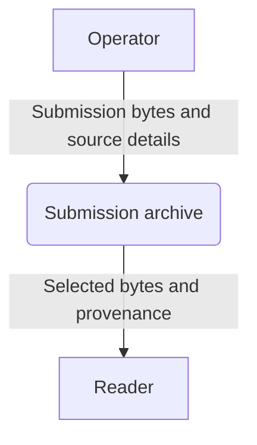
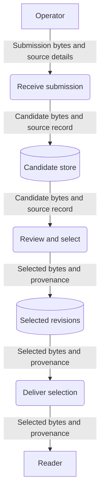

# Data-flow examples

Use [the guide](guide.md) for meaning and notation. Both views below describe a
synthetic proposed submission archive. They show information movement, not
execution timing or deployed network links. The operator and reader are external
to the archive's system boundary. Rectangles are external entities, rounded nodes
are processes, and cylinders are stores. Error handling is omitted from this
focused normal-path example.

## Context: what crosses the archive boundary?

The whole archive is one process. This view intentionally hides its storage and
review internals. The detail below opens that same process.

## Detail: where is the information retained?

The external payloads match the context view. Selection and delivery are processes;
the stores do not perform them. These flows do not say when review happens or who
may approve it; the workflow and contract own those decisions. If delivery instead
returns a reference, change the payload label and document how the reader obtains
the bytes. Do not relabel that reference as retained content.
