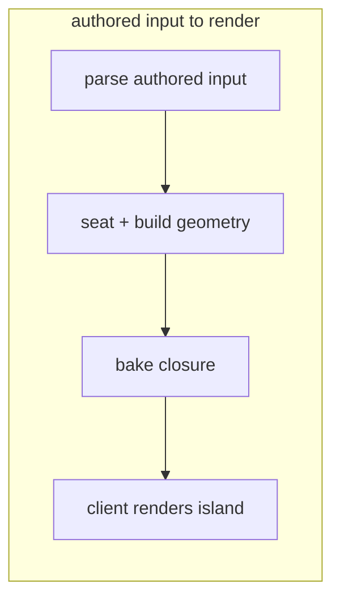
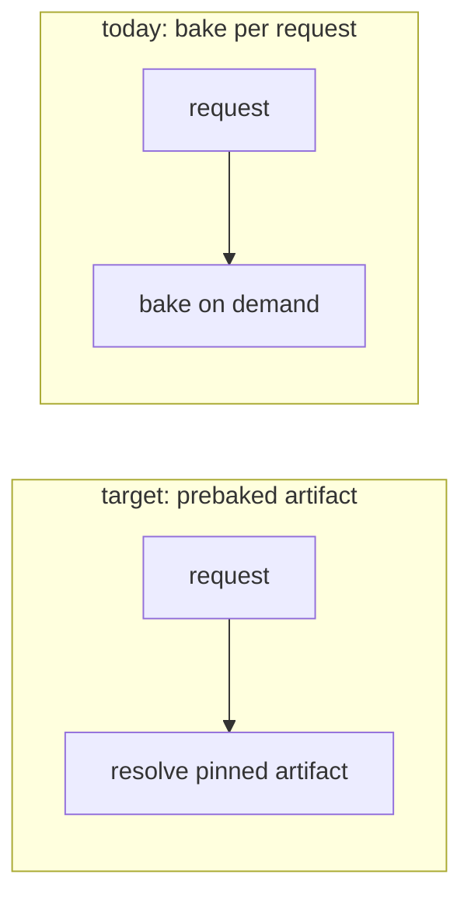
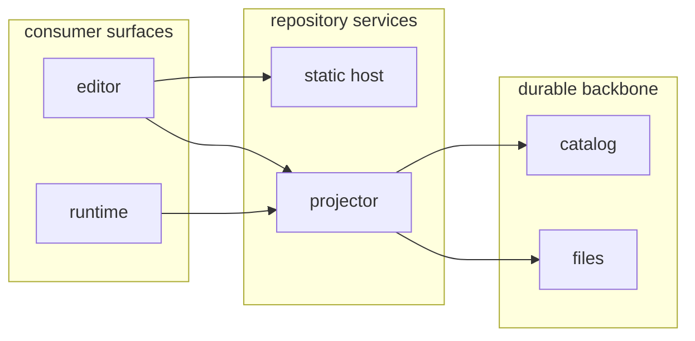
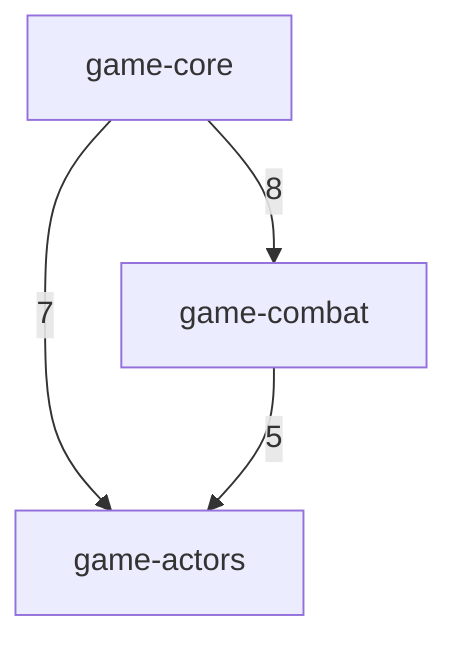

# Drawing conventions

**Read this when implementing or correcting a Mermaid diagram.** `SKILL.md`
decides *which* form carries a subject; this file covers *how* to draw it so it
renders the same on GitHub, in editor previews, and in the live editor. For a
model to copy, see [worked-examples.md](worked-examples.md).

## Default direction: TB

**Top-to-bottom (`flowchart TB`) is the default.** A vertical flow stays within
the narrow column width of a rendered doc or diff and nests subgraphs
predictably.

`TB` and `TD` are aliases for the same layout; Mermaid lists `TB` first and
documents `TD` as an alias, so **write `TB`** — one keyword that reads the same
at the top level and inside a subgraph `direction`.

Reach for `LR` only when the flow is a genuinely short, linear pipeline that
reads better wide _and_ fits the column, or for the layered-overview pattern
below — not as a habit. **When a wide diagram starts wrapping or shrinking text
to fit, switch it to `TB`.**

`TB` alone does not save a diagram carrying too much. When the block is still
too wide after switching, the problem is altitude rather than direction: split
it, using the [composition guidance](composition.md#keep-it-vertical-and-keep-it-at-one-altitude).

## Subgraphs: always declare `direction TB`

A subgraph with **no** explicit `direction` can lay its chain out left-to-right
regardless of the parent flowchart's direction — a Mermaid quirk that makes
nested flows render inconsistently across renderers. Always make the first line
inside a subgraph `direction TB`:

Without that line, the same subgraph may render horizontally and overflow the
page.

## Side-by-side lanes, and how to stack when they do not fit

Two sibling subgraphs with **no connecting edge** between them render side by
side — whatever the parent direction, and whatever order they appear in the
source. That is the natural form for a before/after pair and it is fine to use,
provided **each lane declares `direction TB`** and the finished block still fits
the target column.

Side-by-side lanes that are internally horizontal are the common failure. A
four-node pair drawn without the inner `direction` measured 2495px wide against
a GitHub issue column of roughly 830px, crushing every label to a third of its
size; the same pair with `direction TB` in both lanes measured 1175px. Two
caveats when using this form:

- **Left/right order is not guaranteed.** Mermaid may place the second subgraph
  on the left. Let the subgraph **titles** carry the before/after meaning, rather
  than position.
- **Neither source order nor an inner `direction` moves the lanes.** Both govern
  what happens *inside* a lane, never where the lanes land.

When the pair is still too wide for the column, or reading order must be
guaranteed, stack it deliberately — either two separate Mermaid blocks, or a
single invisible edge between the two subgraph ids, which ranks them vertically:

## Layered overviews: parallel vertical lanes

A **layered overview** has two or more node-bearing subgraphs connected in a
dependency chain. When the layers read more clearly left to right, set the
top-level chart to `flowchart LR` and keep `direction TB` inside every subgraph:

Only the dependency layers move side by side; each layer remains a vertical
lane. Unlike unconnected side-by-side lanes, connecting edges make the
left-to-right layer order meaningful. A before/after pair has no connecting
edge, so this pattern does not apply to it. Use side-by-side lanes, or stack
them, as above, when they do not fit or reading order must be guaranteed.

Treat layered `LR` as a deliberate exception to the `TB` default, not a general
architecture-diagram direction. It spends horizontal space and is most useful
in a full-width README or architecture document. Test the actual render
context: a diagram that wraps or shrinks in a narrow diff, preview, or sidebar
should return to `TB` or split at the correct altitude. Direction does not
override the overview/detail disposition inventory or the lifecycle split
thresholds in `SKILL.md`; classify or split an overfull diagram before choosing
its layout.

## Parallel edges: one edge, labelled with the count

When several edges of the same kind join the same pair of nodes or groups, draw
one edge carrying the count rather than N parallel edges:

N parallel edges between one pair say nothing the number does not, and they are
the cheapest crossings to remove from a dense block. Keep edges separate only
when they differ in something the diagram is read for — cardinality, direction,
or condition. Give a different *kind* of reference its own edge style instead of
adding it to the count, so one number never mixes two meanings.

## Other forms

For Mermaid ER syntax, read [ER guidance](er-diagrams.md#erdiagram).
For Markdown tables, read [tables](tables.md).

## Conservative syntax

Syntax that travels across GitHub, editor previews, and the live editor:

- **`subgraph id [bare title]`** with a space, not a quoted title. Keep Mermaid
  keywords (`direction`, `end`) out of a bare title — they confuse the parser.
- **Quote node labels** — `["…"]` — and use ` ` for line breaks. Quoting keeps
  `(`, `)`, `:` and other punctuation from colliding with node-shape syntax; a
  bare `A[Meshy export (raw)]` is a parse error. Skip other HTML tags — they vary
  by renderer.
- **Never name a node with a reserved keyword** — `click`, `end`, `graph`,
  `subgraph`, `style`, `class`, `direction`, `default`, `call`, `href`,
  `linkStyle`. **`click` is the common trap:** `click["…"]` is read as the
  node-interaction directive, not a node, and the giveaway is a misleading parse
  error reported on the **next** statement, not the offending line. Rename the
  node.
- For a literal `<` or `>` inside a label write `&lt;` / `&gt;` — raw angle
  brackets read as HTML — and avoid `{` `}`, which collide with shape syntax.
- Symmetric dotted-edge syntax: `a -. label .-> b`, with the closing dot before
  the arrow, or `a -.-> b` with no label.
- **`a ~~~ b`** is an invisible link: it ranks the two nodes or subgraphs without
  drawing an edge. Mermaid 9.4 and later, so it travels; use it only to stack
  lanes, never to fake an edge that exists.
