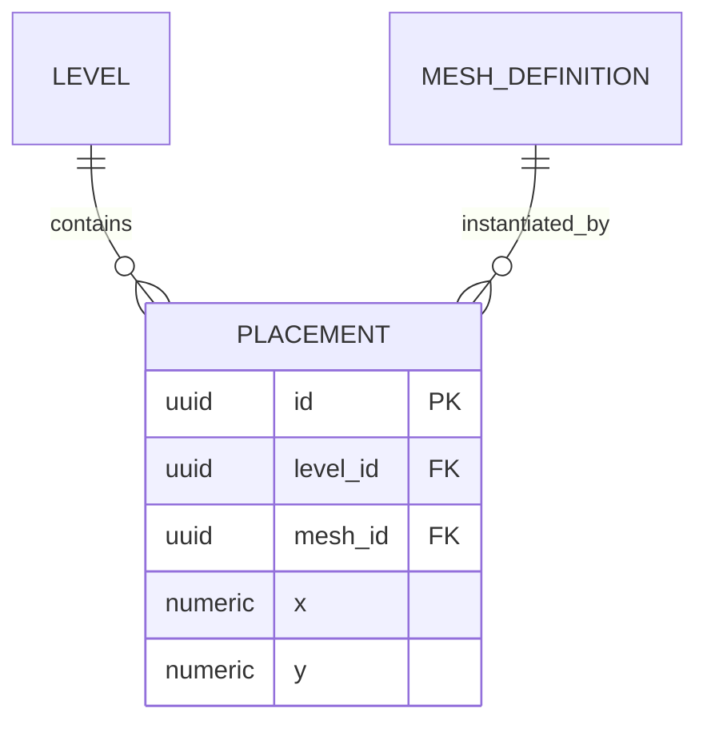

# Entity-relationship diagrams

Use an ER diagram when the reader needs to understand entities and the meaning,
optionality or cardinality of their relationships. Use a flowchart for processing
steps, a sequence diagram for participant interactions, and a state diagram for
one object's allowed transitions.

State whether the view describes a conceptual model, proposed schema or implemented
schema. Derive keys and cardinalities from that source; leave unknowns explicit.
Do not convert a conceptual association into an implemented foreign-key claim.
For relational implementation, database design guidance owns schema decisions;
this reference owns how those decisions are represented.

Read the common [composition](composition.md) and [verification](verification.md)
guidance for scope and evidence, and [drawing](drawing.md) when using Mermaid.
Use a field table alongside the diagram only when those details answer another
needed question. Avoid repeating that inventory in prose.

## Split a large ER view

An `erDiagram` has its own, lower split threshold: **past roughly 10–12
entities, or a comparable number of relationship edges, split the block**.
Current Mermaid supports ER direction and subgraphs, but subgraphs require
Mermaid 11.17.0 or newer; check the target renderer before using them. Neither
control makes a crowded relationship map easy to read. Trimming attributes to
keys and moving column detail to a companion table makes entities narrower, but
it does not raise this ceiling because it fixes width, not the number of
relationships a reader must trace.

Split a large ER model by **aggregate cluster**, as the ER-specific instance of
the same overview/detail black-box pattern above. The root-only overview names
every aggregate root and draws only relationships directly between roots; it
does not open their children. One compact detail diagram per non-atomic root
then opens that root's owned children and join tables. Apply the black-box
disposition inventory to roots too: a root with no load-bearing internal shape
may stay intentionally atomic, while detail owned elsewhere is linked rather
than redrawn.

**When the root-only overview is itself over threshold, raise the altitude
instead of splitting again.** A schema with dozens of aggregate roots has no
useful ER split left beneath it. Group by ownership — one node per document,
page, or migration family that owns the entities — and label each edge with the
number of references crossing that boundary. The nodes stop being tables, so the
block becomes a `flowchart`, showing ownership groups and their dependencies.
Use layout features supported by the target renderer. The flowchart answers a
different question from the diagram it replaces — which groups depend on which,
and the layer order that implies — while each group's own page keeps every
individual relationship at full cardinality.

See [the worked ER split](worked-examples.md#a-large-er-family-split-by-aggregate-cluster)
for the matching stub-elision rule on an aggregate-sized family, and
[the whole-schema overview](worked-examples.md#an-over-threshold-overview-raised-to-its-owning-documents)
for the ownership grouping and the fan-in tables that keep its hubs from being
drawn as table-level nodes.

## `erDiagram`

Use `erDiagram` for entities and their relationships, and a Markdown table for
the field-level detail.

**Each end's symbol describes the entity beside it:** in
`LEVEL ||--o{ PLACEMENT`, each placement belongs to exactly one level, and a
level contains zero or more placements. `||--o{` is the common one-to-many. The
symbols mirror across the line:

| Meaning | Left end | Right end |
| --- | --- | --- |
| exactly one | `\|\|` | `\|\|` |
| zero or one | `\|o` | `o\|` |
| zero or more | `}o` | `o{` |
| one or more | `}\|` | `\|{` |

- **Every relationship needs a label** — a bare `A ||--o{ B` is still a parse
  error on current Mermaid. Write `: ""` when there is genuinely nothing to
  say. Quote a label that is a cardinality word, such as `: "one"` or
  `: "many"`; unquoted, Mermaid reads it as cardinality and fails to parse.
- **Never leave a space in an unquoted entity name.** `MESH DEFINITION` does not
  fail — it silently becomes *two* entities, `MESH` and `DEFINITION`, and the
  diagram renders as if that were intended. Use `MESH_DEFINITION`, or quote the
  name. Uppercase is the convention.
- **Use the storage's real types** in attribute lines, and mark `PK` / `FK` /
  `UK`; a trailing quoted string on the line is a comment. An ER diagram whose
  types are invented is worse than none.
- **Show the delta, not the whole schema.** Draw the entities the change
  touches plus their immediate neighbours; link to the schema's canonical home
  for the rest.
- **ER direction and subgraphs depend on the target Mermaid renderer.** Current
  [Mermaid ER syntax](https://mermaid.js.org/syntax/entityRelationshipDiagram.html)
  supports both, but ER subgraphs require version 11.17.0 or newer. Check the
  project's preview or publishing renderer before using them, and read the
  version of the Mermaid package it runs, not of a CLI wrapped around it. An
  older renderer does not reject an ER subgraph: Mermaid 11.16.1 draws
  `subgraph` and `end` as two extra entities. With or without those controls,
  split past roughly 10–12 entities, or a comparable edge count, even when
  every attribute block is already keys-only. Attribute trimming reduces width;
  it does not make a crowded relationship layout tractable.
- **Split by aggregate cluster.** Start with one root-only overview naming every
  aggregate root and only the edges directly between roots, with no children.
  Then open each non-atomic root in its own compact detail `erDiagram`, showing
  its owned children and join tables. This is the ER form of the
  overview/detail black-box pattern in `SKILL.md`, not flowchart-style staging.
- **Elide cross-family stubs unless their cardinality carries information.** A
  target earns a drawn entity and edge only when the relationship distinguishes
  one-to-one from one-to-many for this diagram's own question. For a single
  incoming FK already named in prose or the column table, keep the target
  discoverable as an attribute comment instead:
  `text race_key FK "-> game_races.key"`. That costs no extra entity or
  edge.
- **A target reached by many entities is a fan-in table, not a drawn hub.**
  Shared dependency is the one shape an ER layout cannot absorb: a node with a
  dozen incoming edges crosses every other edge in the block, and it is
  routinely what makes an otherwise splittable diagram unsplittable. When fan-in
  *is* the shape worth showing, tabulate it — one row per referencing entity or
  group, the target named once in the heading — and leave the hub out of the
  graph entirely. Table rows do not cross. `SKILL.md` carries the fan-in shape
  beside the other table shapes.
