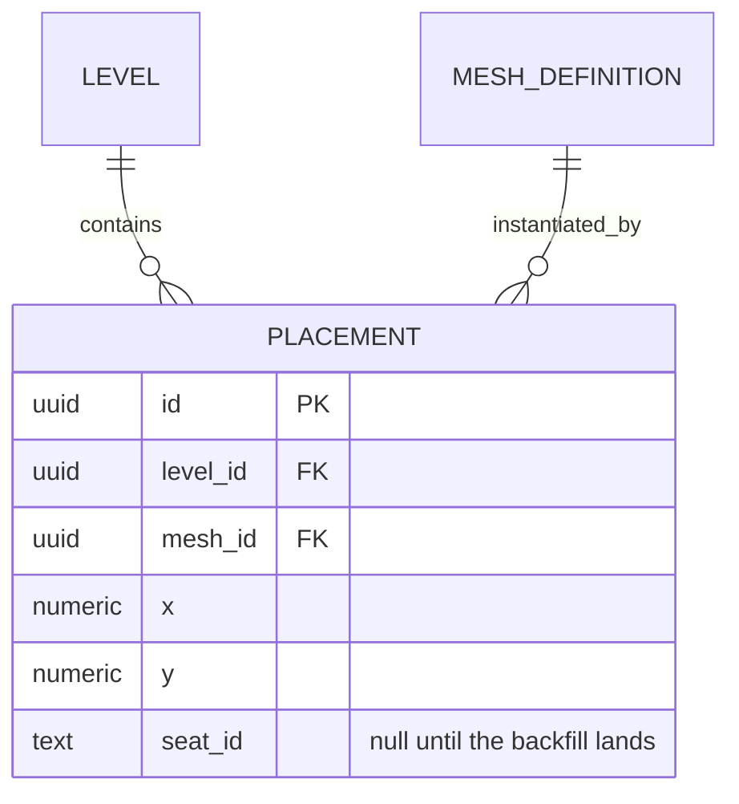
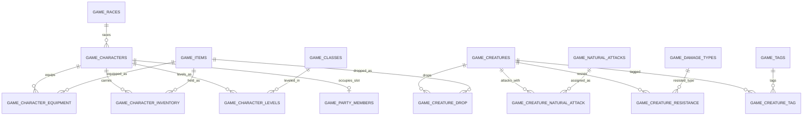
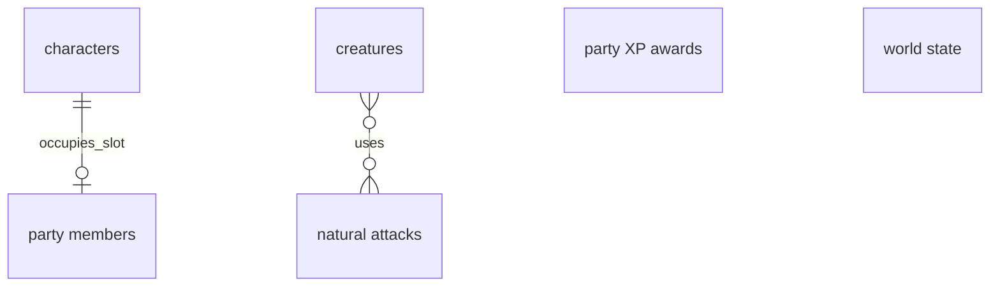
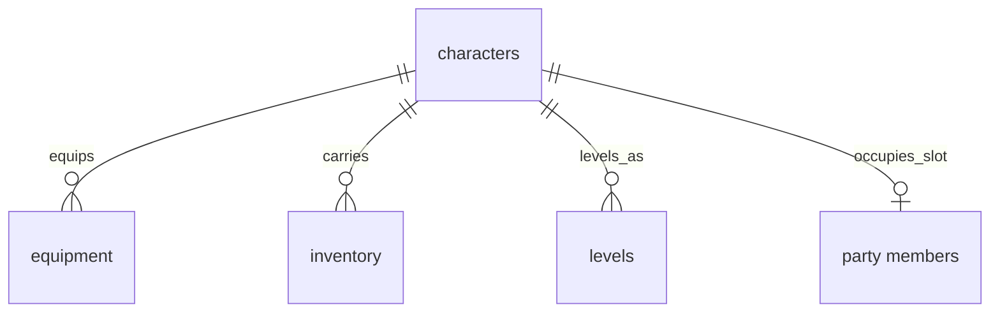
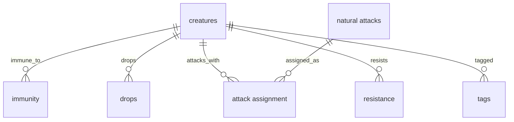
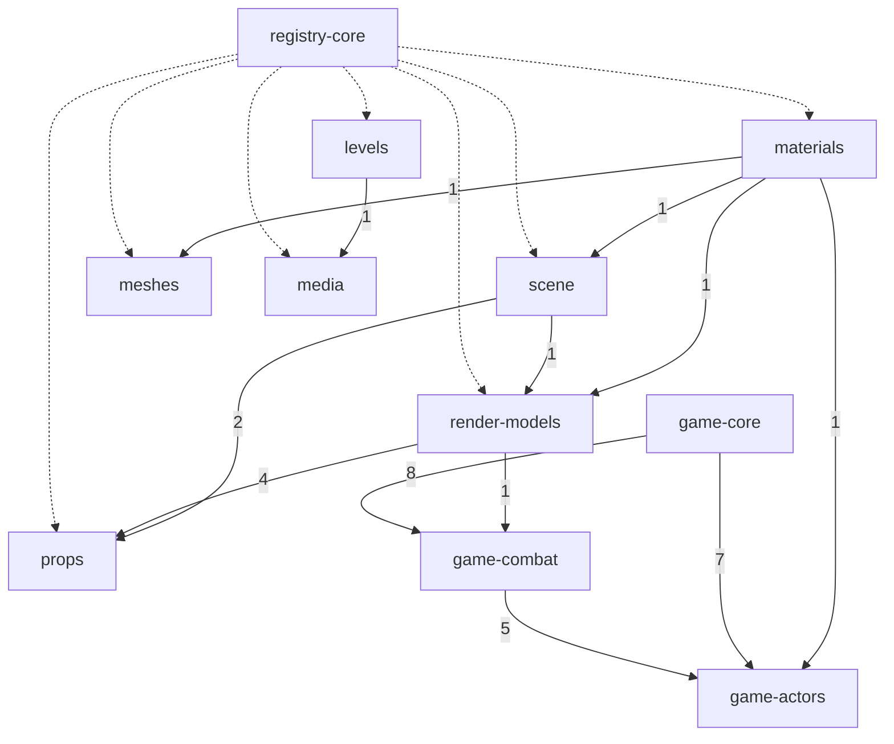

# ER examples

Read [the ER guide](guide.md) for notation and [large models](large-models.md)
when decomposition is needed. These examples illustrate proposed or generalized
models; they do not establish a consumer project schema.

## A schema change: ER diagram plus a delta table

**Replaces:** prose walking through each altered column. Two forms, never three
— the diagram carries the relationships, the table carries the field-level
delta, and no paragraph restates either.

The diagram shows the touched entities after the change:

| Column | Before | After | Migration |
| --- | --- | --- | --- |
| `placement.mesh_id` | `text`, the mesh's name | `uuid`, FK to `mesh_definition.id` | backfill by name, then drop the text column |
| `placement.seat_id` | absent | `text`, nullable | added empty; nullable until the backfill lands |
| `placement.x` / `.y` | `float` | `numeric(9,3)` | validate range and rounding before casting; precision may be lost |
| `placement.legacy_ref` | `text` | dropped | none — unread since the archive cut |

For this PostgreSQL example, [numeric precision and scale](https://www.postgresql.org/docs/current/datatype-numeric.html)
can cause rounding or reject an out-of-range value. The table names a proposed
migration check; it is not evidence that existing data passes it.

## A large ER family split by aggregate cluster

**Source shape:** a game database family, generalized from a real
repository.

**Replaces:** the game registry family once drawn as one keys-only
`erDiagram`: fourteen owned tables, nine cross-family target stubs, and
twenty-three relationship edges in one unclustered layout. Moving full columns
to a companion table made the entity boxes thinner, but the remaining graph was
still too dense to read. ER direction or subgraphs, where the renderer supports
them, would arrange the same twenty-three edges without reducing them.

The crowded version mixed aggregate roots, owned children, join tables, and
every single-FK target in one block. Even this relationship-only excerpt shows
the competing clusters and stubs; the source shape had twenty-three entities
and twenty-three edges:

Split first to a root-only overview. It names every aggregate root, keeps the
direct character-to-party cardinality, and summarizes the many-to-many
creature-to-attack relationship carried by the assignment table. The two
standalone roots stay intentionally atomic because they have no children to
open:

Then open one aggregate at a time. The character detail keeps its three owned
children and immediate party seam. Short display labels keep the relationships
readable; the companion table maps each label to its entity and keeps the key
fields and cross-family FK targets:

| Diagram label | Entity and selected fields |
| --- | --- |
| `characters` | `game_characters`: `text key` PK; `text race_key` FK → `game_races.key` |
| `equipment` | `game_character_equipment`: `text character_key` PK, FK; `text slot` PK; `text item_key` FK → `game_items.key` |
| `inventory` | `game_character_inventory`: `text character_key` PK, FK; `text item_key` PK, FK → `game_items.key` |
| `levels` | `game_character_levels`: `text character_key` PK, FK; `integer char_level` PK; `text class_key` FK → `game_classes.key` |
| `party members` | `game_party_members`; fields are outside this example |

The creature detail independently opens its children and the join table that
carries the root-to-root natural-attack relationship. Its cross-family targets
stay in the companion table rather than becoming drawn hubs. Where that shared
dependency is itself the question, it belongs in a fan-in table, as the next
example shows.

| Diagram label | Entity and selected fields |
| --- | --- |
| `creatures` | `game_creatures`: `text key` PK; `text class_key` FK → `game_classes.key`; `text template_key` FK → `game_templates.key`; `text dice_material_appearance_ref` FK → `material_appearances.ref` |
| `immunity` | `game_creature_condition_immunity`: `text creature_key` PK, FK; `text condition_key` PK, FK → `game_conditions.key` |
| `drops` | `game_creature_drop`: `text creature_key` PK, FK; `text item_key` PK, FK → `game_items.key` |
| `attack assignment` | `game_creature_natural_attack`: `text creature_key` PK, FK; `text natural_attack_key` PK, FK |
| `resistance` | `game_creature_resistance`: `text creature_key` PK, FK; `text damage_type_key` PK, FK → `game_damage_types.key` |
| `tags` | `game_creature_tag`: `text creature_key` PK, FK; `text tag_key` PK, FK → `game_tags.key` |
| `natural attacks` | `game_natural_attacks`: `text key` PK; `text damage_type_key` FK → `game_damage_types.key`; `text scales_with` FK → `game_attributes.key` |

The overview and details are one two-altitude set. The companion tables retain
the selected key fields and cross-family targets; a full schema column table
would also own nullability, defaults, and constraints. Splitting the ER layout
does not add a third form.

## An over-threshold overview raised to its owning documents

**Source shape:** a registry schema's relations overview, generalized from a real
repository, replaced by per-aggregate diagrams in the documents that own them.

**Replaces:** one `erDiagram` naming every table in the schema — 96 entities and
122 relationship edges in a single flat block, several times over the ER split
threshold. The aggregate-cluster split above does not help here: the schema
carries roughly forty plausible aggregate roots across eleven families, so even
a root-only overview stays too crowded to read.

The measurement that chose the remedy was not the entity count. It was this:
**all 122 edges were already drawn on a family page** — 76 inside a family, 46
crossing a boundary — each with its real optionality and a verb label, beside
the columns carrying the constraint. The overview held no fact of its own, and
held every fact it copied less well, since it flattened all 122 to `||--o{` with
an empty label.

That is a duplication finding, not a density finding, and the two have different
fixes. Density prescribes a split, and a correctly split set would still have
duplicated all 122 edges. Duplication prescribes deleting the block and drawing
the altitude above it.

This representative excerpt of the replaced block keeps the two hubs and one
family's own edges, which are enough to show why no ER split rescues it; the
frozen source owns the full inventory:

```mermaid
erDiagram
  BLOB ||--o{ ASSET_REVISIONS : ""
  BLOB ||--o{ MATERIAL_ASSETS : ""
  BLOB ||--o{ SKYBOXES : ""
  BLOB ||--o{ RENDER_MODELS : ""
  BLOB ||--o{ MESH_ARTIFACTS : ""
  BLOB ||--o{ PROP_HUD_ASSETS : ""
  BLOB ||--o{ FONTS : ""
  BLOB ||--o{ LEVEL_BAKE_ARTIFACTS : ""
  GAME_DAMAGE_TYPES ||--o{ GAME_WEAPON_DAMAGE : ""
  GAME_DAMAGE_TYPES ||--o{ GAME_SPELL_DAMAGE : ""
  GAME_DAMAGE_TYPES ||--o{ GAME_CREATURE_RESISTANCE : ""
  GAME_DAMAGE_TYPES ||--o{ GAME_NATURAL_ATTACKS : ""
  GAME_TAGS ||--o{ GAME_CONDITION_TAG : ""
  GAME_TAGS ||--o{ GAME_CREATURE_TAG : ""
  LEVEL_ROOTS ||--o{ LEVEL_ENCOUNTERS : ""
  LEVEL_ROOTS ||--o{ LEVEL_HANDLES : ""
```

The altitude above a table is the document that owns it. The family map draws
one node per migration family, which is also one node per family page,
and labels each edge with the number of foreign keys crossing that boundary. The
nodes are no longer tables, so the form is a `flowchart`.

The family map shows foreign-key dependencies and their layer order, with one
node per family page.

Eleven nodes and nineteen edges replace ninety-six and one hundred and
twenty-two, and the layer order becomes legible for the first time: the asset
families stack, the game families stack separately, and the two stacks meet
at exactly two edges. Collapsed counts are what make it readable: the eight
foreign keys from game-core into game-combat are one labelled edge, not eight
parallel ones. The dotted edges mark families whose tables hold a `blob`
foreign key; `blob` belongs to registry-core. They are a different *kind* of
reference, so they carry no count that could be added to the solid ones.

Neither hub is drawn as a table-level node. Between them they account for 28 of
the 46 cross-family edges: 13 of `blob`'s 15 referencing tables sit outside its
own family, and all 15 game-core references cross a boundary. So drawing either
hub would have put most of the crossings straight back. The map carries them
only as family edges: registry-core's dotted edges and game-core's two counted
edges. Each becomes a fan-in table beneath the map, with the hub named in the
heading rather than drawn:

| Family | Tables holding a `blob` foreign key |
| --- | --- |
| registry-core | `asset_revisions`, `publish_lineage` |
| materials | `material_assets` |
| scene | `skyboxes` |
| render-models | `render_models`, `render_model_appearances` |
| meshes | `mesh_artifacts` |
| props | `prop_hud_assets` |
| media | `creatures`, `fonts`, `font_representations`, `heightmaps`, `music`, `sounds` |
| levels | `level_bake_artifacts` |

| game-core table | Referenced from combat | Referenced from actors |
| --- | --- | --- |
| `game_damage_types` | `condition_damage`, `spell_damage`, `template_resistance`, `weapon_damage` | `creature_resistance`, `natural_attacks` |
| `game_tags` | `condition_tag`, `template_tag` | `creature_tag` |
| `game_attributes` | `weapons` | `natural_attacks` |
| `game_classes` | none | `character_levels`, `creatures` |
| `game_schools` | `spells` | none |
| `game_races` | none | `characters` |

The two tables put their rows on **different axes on purpose**, and choosing that
axis is the main decision in building this shape: `blob` is one target reached
from many places, so the referencing families are the rows; game-core is many
targets each reached from two places, so the targets are the rows and the
referencing families are the columns. Pick whichever axis makes one row a single
fact. The second table's `none` cells show why the fill-every-cell rule matters:
an empty cell would have read as an oversight rather than as a real asymmetry.

Nothing was lost in the deletion, because the overview owned no fact of its own.
The family pages still own every one of the 122 relationships at full
cardinality; this altitude owns only the shapes no single family page can see.
