# Worked examples

**Read this when you know which form you need and want a model to copy.**
`SKILL.md` decides the form; [mermaid.md](mermaid.md) covers the syntax. Each
example below names the failure it replaces, so it is clear what the shape is
buying. ER-specific models live in [ER examples](er/examples.md);
data movement has [data-flow examples](data-flow/examples.md).

## An overview and its detail, instead of one wide block

**Replaces:** one flowchart holding an authoring lane, a publish boundary, and a
delivery lane side by side — three altitudes in one block, which renders as
squeezed lanes with unreadable labels.

The overview keeps the complex part as a single node:

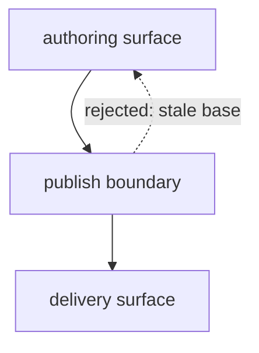

The detail diagram opens that one node, in the doc that owns it. Its title
repeats the black box's label exactly, so a reader knows what they opened.

The publish boundary checks the candidate in this order.

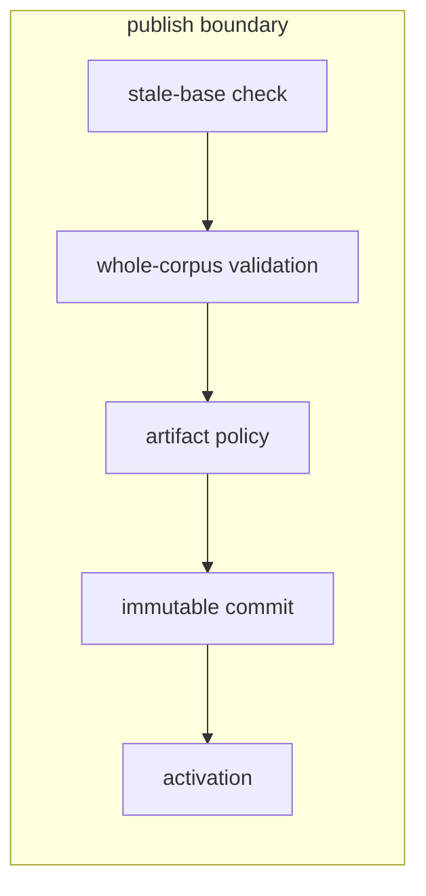

Each diagram now answers one question at full column width. The detail's opening
names the boundary; review the detail against its source when that boundary
changes.

## One overview fanning out to several owned details

**Replaces:** a black-box overview whose outbound links leave locally owned
components unopened, or one oversized diagram that mixes system ownership with
every component's internal flow.

The overview answers only which components meet at the artifact registry:

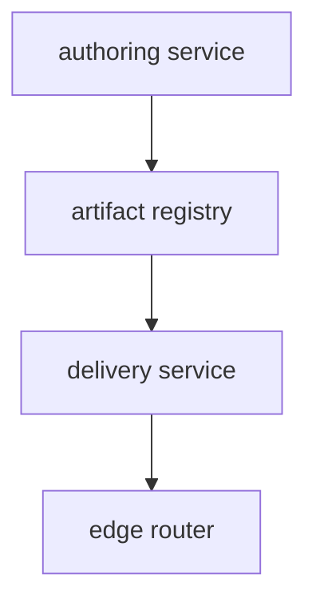

Inventory every black box before drawing details:

| Overview box | Disposition | Reason or destination |
| --- | --- | --- |
| `authoring service` | compact detail here | this doc owns its validation boundary |
| `artifact registry` | canonical detail elsewhere | the storage contract owns its internals |
| `delivery service` | compact detail here | this doc owns its resolution boundary |
| `edge router` | intentionally atomic | only its public handoff matters at this altitude |

The two locally owned boxes each get a compact detail at the same altitude. The
exact overview label appears again, and only the immediate external seams are
redrawn.

The authoring service validates edits before handing them to the artifact registry.

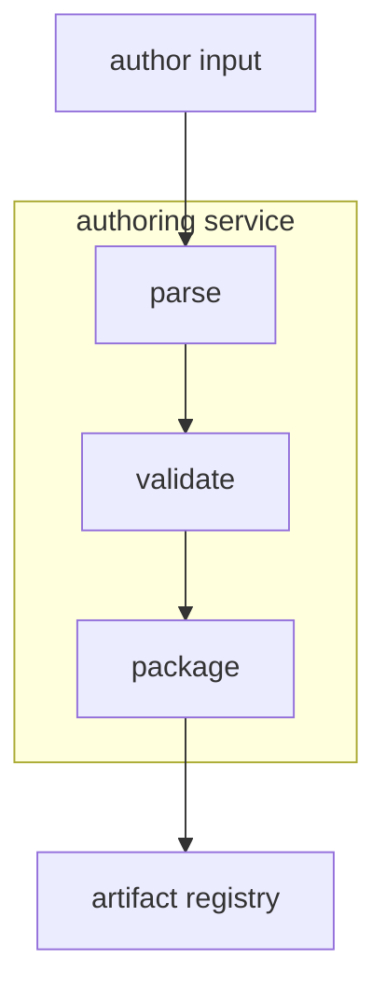

The delivery service resolves a published artifact for the edge router.

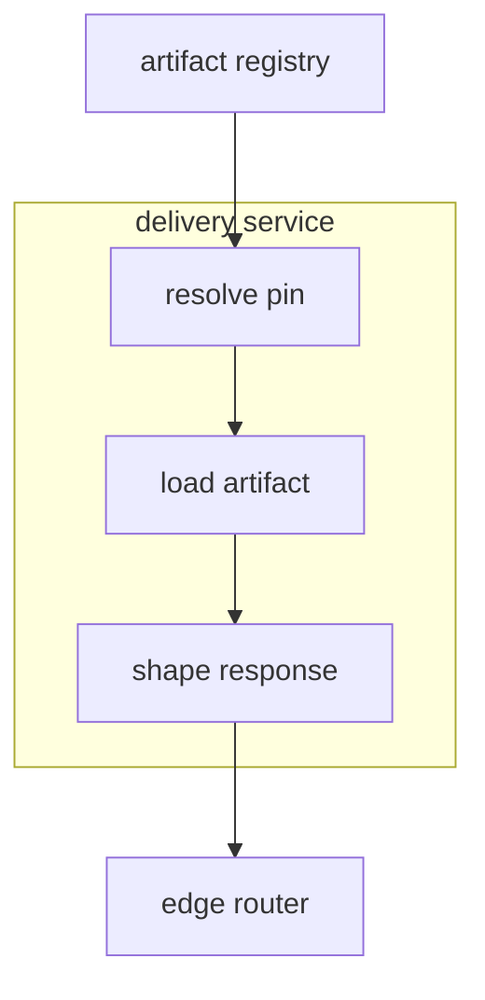

The artifact registry links to its canonical storage detail instead of being
redrawn, and the edge router stays closed for a stated reason. If the reader
also needs request order or retry behavior, draw a separate lifecycle diagram;
that question does not belong inside this ownership set.

## A multi-phase lifecycle split by stage-level question

**Replaces:** one lifecycle that expands every relevant input, optional build
step, and finalization state. No single subgraph has to be enormous for the
whole diagram to answer too many useful questions at once.

The stable-stage overview carries only the end-to-end order. Repeated inputs,
the optional branch's internals, and routine finalization states are collapsed:

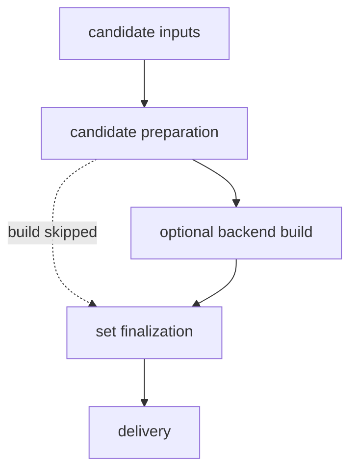

The black-box inventory applies just as it does to a component overview:

| Lifecycle stage | Disposition | Reason or destination |
| --- | --- | --- |
| `candidate inputs` | compact detail here | input fan-in and precedence matter |
| `candidate preparation` | intentionally atomic | its public outcome is enough here |
| `optional backend build` | compact detail here | the conditional lane has load-bearing order |
| `set finalization` | compact detail here | activation states and handoffs matter |
| `delivery` | canonical detail elsewhere | the delivery contract owns its internals |

Each focused detail answers one stage-level question and repeats the overview
label exactly.

Candidate inputs converge on candidate preparation.

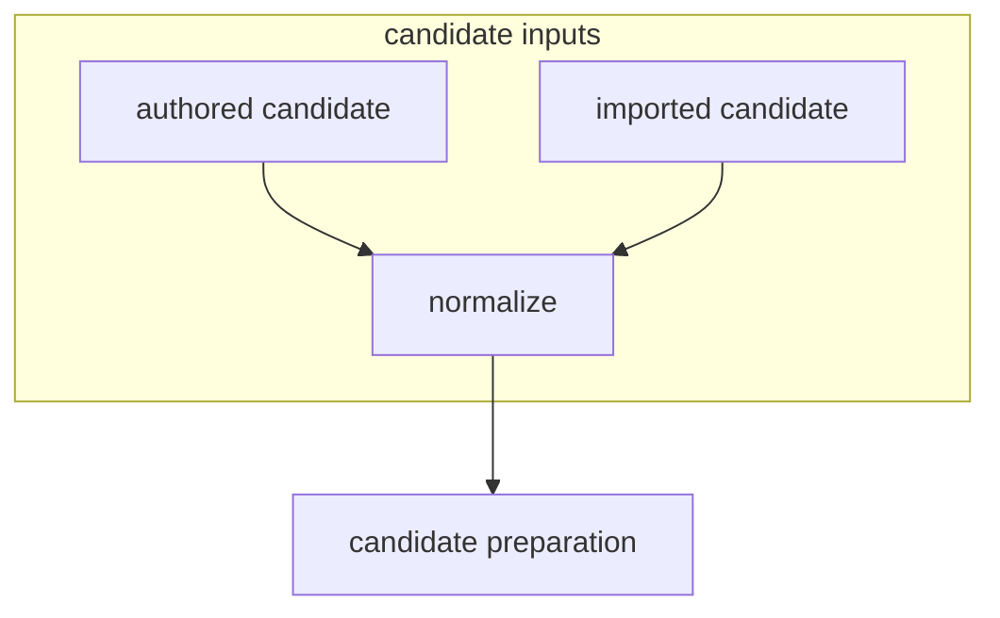

The optional backend build completes before set finalization.

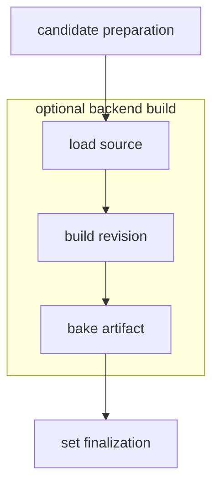

Set finalization commits and activates the selection before delivery.

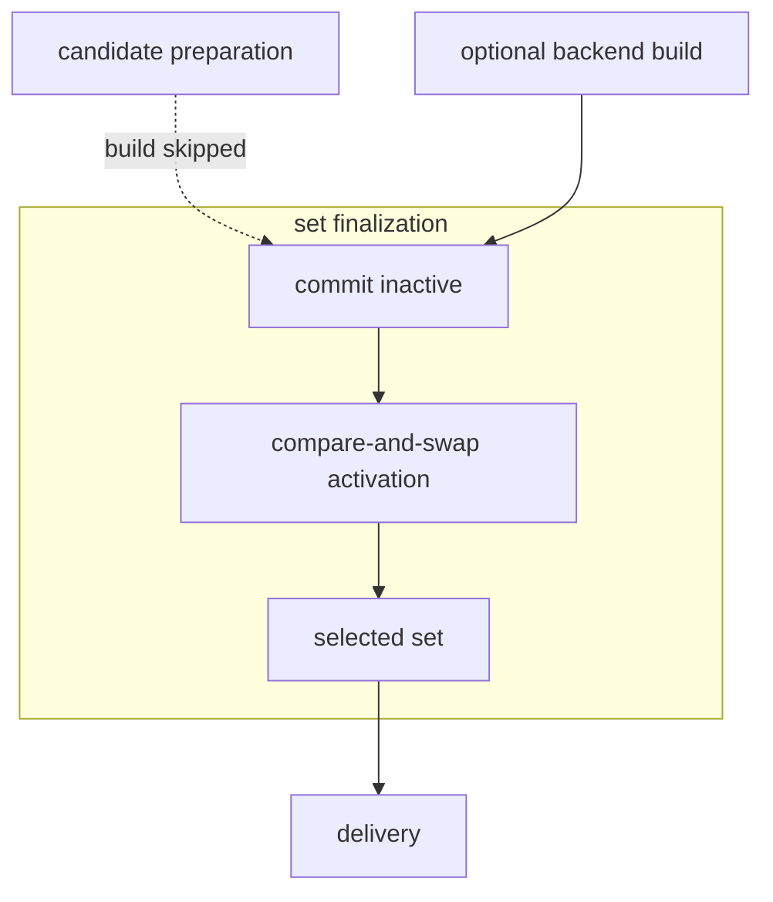

Every node from the oversized version can still be relevant. The split moves
each ordering fact to the diagram whose question needs it; it does not discard
those facts or introduce a third altitude.

## Before / after as parallel vertical lanes

**Replaces:** a paragraph saying "today the response is baked per request;
afterwards it resolves a pinned artifact instead" — true, but the reader has to
hold both flows in their head to see where they diverge.

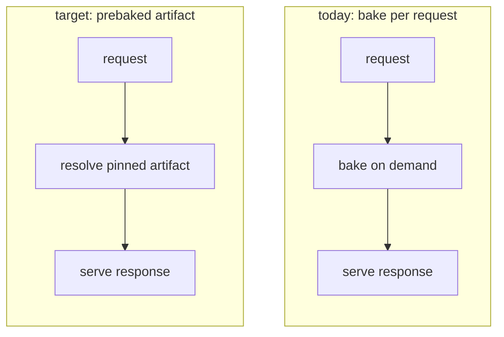

The two unconnected subgraphs sit **side by side**; `direction TB` is what keeps
each lane running top to bottom inside its own box. Omit those two lines and the
same block renders as two horizontal chains several times the column width. When
a pair this size no longer fits, stack it — see `mermaid.md`.

The lanes are **comparable on purpose**: three stages each, identical first and
last node, so the single differing stage is the change. A before lane drawn in
six nodes against an after lane of three would hide exactly what it exists to
show.

## A layered overview as parallel vertical lanes

**Source shape:** a content platform's outer dependency map, generalized from a
real repository.

The representative slice below keeps the cross-layer fan-out that determines the
layout; the original owns the complete node and edge inventory.

**Replaces:** the same three dependency-ordered groups stacked in a top-level
`flowchart TB`. Each group was locally readable, but cross-group fan-out met in
one crowded horizontal band and forced readers to trace long diagonal edges.

The crowded layout used vertical subgraphs inside a vertical chart:

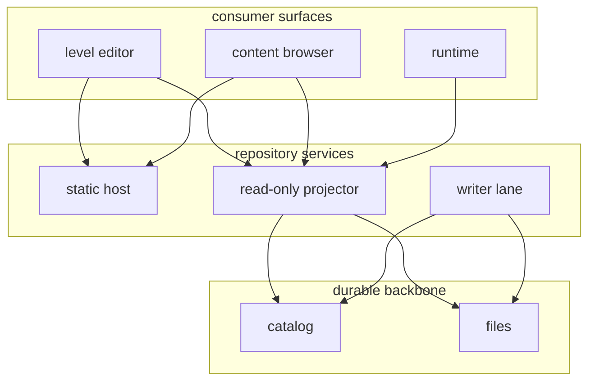

Changing only the top-level direction makes the dependency groups parallel
lanes while preserving each lane's vertical node order:

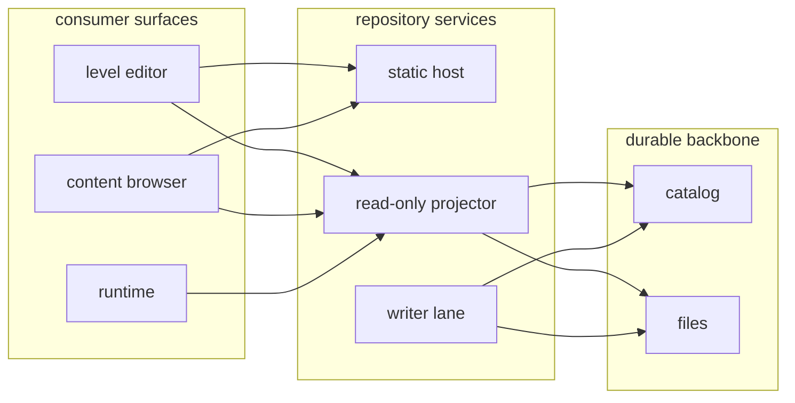

This is a layout change, not an altitude change: the groups already pass the
overview black-box disposition inventory and whole-diagram split tests. If a
lane hides important internals, or the chart also makes readers understand
independent lifecycle phases, open or split those questions first. Use this
wide form only where the actual render gives its lanes enough horizontal room.

## A coverage matrix

**Replaces:** a section describing each surface in turn. Prose can cover all
three surfaces honestly and still never reveal that one of them answers nothing.

| Surface | Validates on write | Emits audit event | Owns rollback |
| --- | --- | --- | --- |
| editor UI | yes | yes | no — delegates to publish |
| publish API | yes | yes | yes |
| bulk importer | **unknown** | no | **none** |

The importer row is the finding. Two cells nobody could fill are worth more than
the seven that were easy, and they are visible at a glance — which is the whole
argument for the matrix over the paragraph.

## A decision matrix

**Replaces:** three paragraphs arguing for the chosen option. The matrix makes
the runners-up legible enough to be argued *against*, which is what a keystone
decision needs.

| Option | Effort | Reversible | Cost when wrong |
| --- | --- | --- | --- |
| **bake at publish** (chosen) | medium | yes — republish | stale artifacts until the next publish |
| bake per request | low | yes | latency on every read, permanently |
| bake nightly | low | no — batch window is fixed | a day of stale reads before anyone notices |

Prose then carries only what the table cannot: *why* reversibility and the
cost of being wrong outrank effort here. Effort is paid once; an irreversible
choice, or one that charges every read, keeps costing after the work is done.
