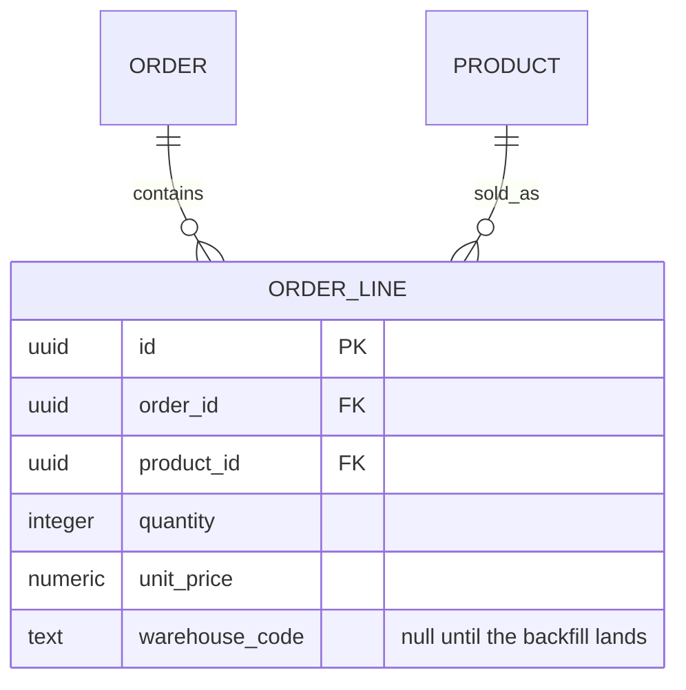
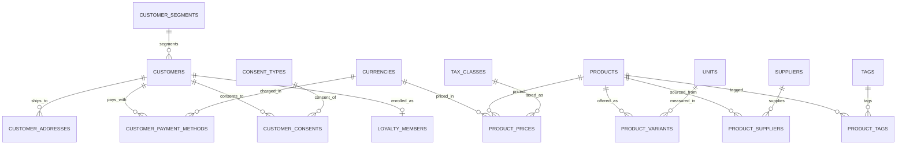
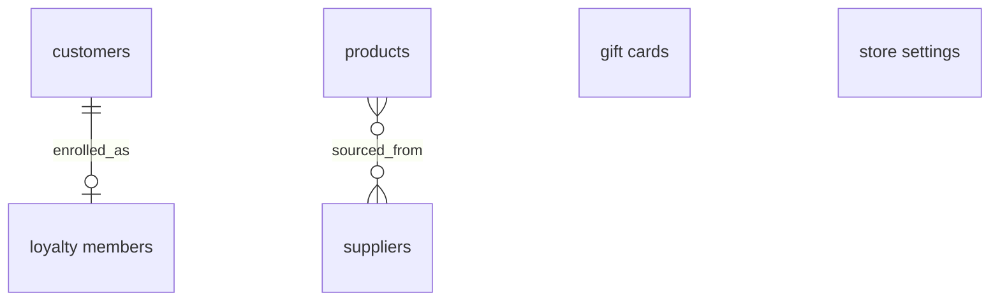
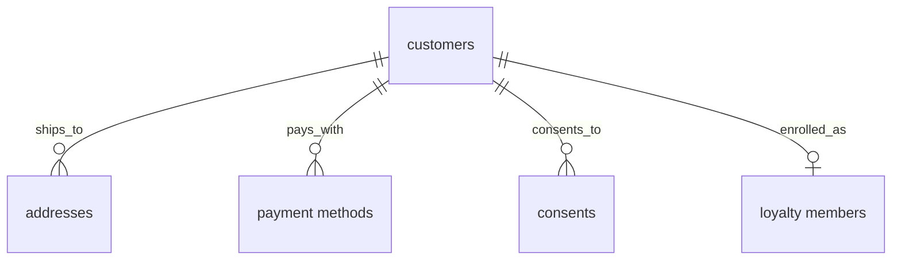
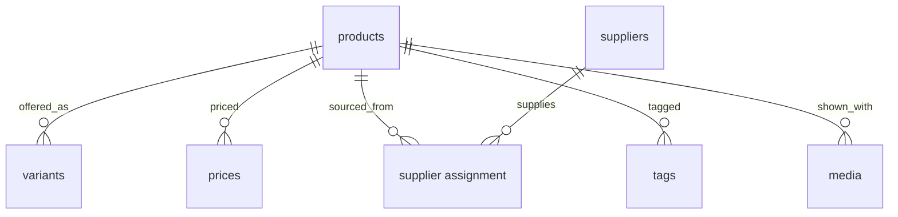
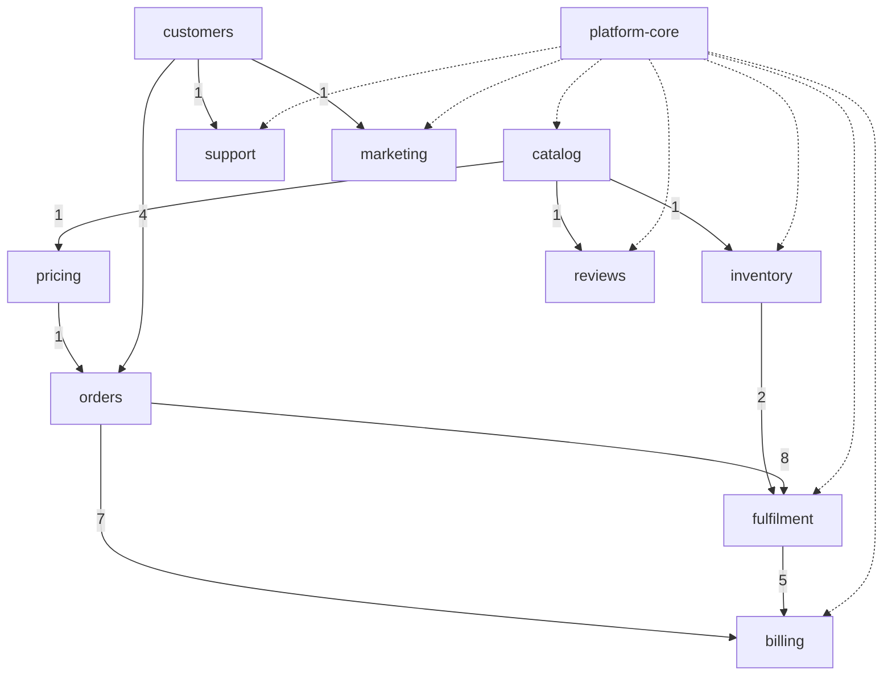

# ER examples

Read [the ER guide](guide.md) for notation and [large models](large-models.md)
when decomposition is needed. These examples use a synthetic commerce schema;
they illustrate the shapes and do not describe any real project's database.

## A schema change: ER diagram plus a delta table

**Replaces:** prose walking through each altered column. Two forms, never three
— the diagram carries the relationships, the table carries the field-level
delta, and no paragraph restates either.

The diagram shows the touched entities after the change:

| Column | Before | After | Migration |
| --- | --- | --- | --- |
| `order_line.product_id` | `text`, the product's SKU | `uuid`, FK to `product.id` | backfill by SKU, then drop the text column |
| `order_line.warehouse_code` | absent | `text`, nullable | added empty; nullable until the backfill lands |
| `order_line.unit_price` | `float` | `numeric(12,2)` | validate range and rounding before casting; precision may be lost |
| `order_line.legacy_ref` | `text` | dropped | none — unread since the old importer was retired |

For this PostgreSQL example, [numeric precision and scale](https://www.postgresql.org/docs/current/datatype-numeric.html)
can cause rounding or reject an out-of-range value. The table names a proposed
migration check; it is not evidence that existing data passes it.

## A large ER family split by aggregate cluster

**Replaces:** a catalog-and-customer family once drawn as one keys-only
`erDiagram`: fourteen owned tables, nine cross-family target stubs, and
twenty-three relationship edges in one unclustered layout. Moving full columns
to a companion table made the entity boxes thinner, but the remaining graph was
still too dense to read. ER direction or subgraphs, where the renderer supports
them, would arrange the same twenty-three edges without reducing them.

The crowded version mixed aggregate roots, owned children, join tables, and
every single-FK target in one block. Even this relationship-only excerpt shows
the competing clusters and stubs:

Split first to a root-only overview. It names every aggregate root, keeps the
direct customer-to-loyalty cardinality, and summarizes the many-to-many
product-to-supplier relationship carried by the join table. The two standalone
roots stay intentionally atomic because they have no children to open:

Then open one aggregate at a time. The customer detail keeps its three owned
children and immediate loyalty seam. Short display labels keep the relationships
readable; the companion table maps each label to its entity and keeps the key
fields and cross-family FK targets:

| Diagram label | Entity and selected fields |
| --- | --- |
| `customers` | `customers`: `text key` PK; `text segment_key` FK → `customer_segments.key` |
| `addresses` | `customer_addresses`: `text customer_key` PK, FK; `text label` PK; `text country_code` FK → `countries.code` |
| `payment methods` | `customer_payment_methods`: `text customer_key` PK, FK; `text method_key` PK; `text currency_code` FK → `currencies.code` |
| `consents` | `customer_consents`: `text customer_key` PK, FK; `text consent_type_key` PK, FK → `consent_types.key` |
| `loyalty members` | `loyalty_members`; fields are outside this example |

The product detail independently opens its children and the join table that
carries the root-to-root supplier relationship. Its cross-family targets stay in
the companion table rather than becoming drawn hubs. Where that shared
dependency is itself the question, it belongs in a fan-in table, as the next
example shows.

| Diagram label | Entity and selected fields |
| --- | --- |
| `products` | `products`: `text key` PK; `text category_key` FK → `categories.key`; `text brand_key` FK → `brands.key` |
| `variants` | `product_variants`: `text product_key` PK, FK; `text sku` PK; `text unit_key` FK → `units.key` |
| `prices` | `product_prices`: `text product_key` PK, FK; `text currency_code` PK, FK → `currencies.code`; `text tax_class_key` FK → `tax_classes.key` |
| `supplier assignment` | `product_suppliers`: `text product_key` PK, FK; `text supplier_key` PK, FK |
| `tags` | `product_tags`: `text product_key` PK, FK; `text tag_key` PK, FK → `tags.key` |
| `media` | `product_media`: `text product_key` PK, FK; `integer position` PK; `uuid attachment_id` FK → `attachments.id` |
| `suppliers` | `suppliers`: `text key` PK; `text country_code` FK → `countries.code`; `text currency_code` FK → `currencies.code` |

The overview and details are one two-altitude set. The companion tables retain
the selected key fields and cross-family targets; a full schema column table
would also own nullability, defaults, and constraints. Splitting the ER layout
does not add a third form.

## An over-threshold overview raised to its owning documents

**Replaces:** one `erDiagram` naming every table in the schema — in this
synthetic case about ninety entities and one hundred and twenty relationship
edges in a single flat block, several times over the ER split threshold. The
aggregate-cluster split above does not help here: the schema carries dozens of
plausible aggregate roots across eleven families, so even a root-only overview
stays too crowded to read.

The measurement that chose the remedy was not the entity count. It was this:
**every one of the 120 edges was already drawn on a family page** — about 75
inside a family, about 45 crossing a boundary — each with its real optionality
and a verb label, beside the columns carrying the constraint. The overview held
no fact of its own, and held every fact it copied less well, since it flattened
all of them to `||--o{` with an empty label.

That is a duplication finding, not a density finding, and the two have different
fixes. Density prescribes a split, and a correctly split set would still have
duplicated all 120 edges. Duplication prescribes deleting the block and drawing
the altitude above it.

This representative excerpt of the replaced block keeps the two hubs and one
family's own edges, which are enough to show why no ER split rescues it; the
family pages own the full inventory:

```mermaid
erDiagram
  ATTACHMENTS ||--o{ PRODUCT_MEDIA : ""
  ATTACHMENTS ||--o{ CATEGORY_BANNERS : ""
  ATTACHMENTS ||--o{ INVOICE_DOCUMENTS : ""
  ATTACHMENTS ||--o{ SHIPMENT_LABELS : ""
  ATTACHMENTS ||--o{ RETURN_PHOTOS : ""
  ATTACHMENTS ||--o{ SUPPORT_TICKET_FILES : ""
  ATTACHMENTS ||--o{ CAMPAIGN_ASSETS : ""
  ATTACHMENTS ||--o{ REVIEW_IMAGES : ""
  CURRENCIES ||--o{ PRODUCT_PRICES : ""
  CURRENCIES ||--o{ INVOICES : ""
  CURRENCIES ||--o{ REFUNDS : ""
  CURRENCIES ||--o{ SUPPLIER_CONTRACTS : ""
  TAX_CLASSES ||--o{ PRODUCT_PRICES : ""
  TAX_CLASSES ||--o{ INVOICE_LINES : ""
  ORDERS ||--o{ ORDER_LINES : ""
  ORDERS ||--o{ ORDER_EVENTS : ""
```

The altitude above a table is the document that owns it. The family map draws
one node per schema family, which is also one node per family page, and labels
each edge with the number of foreign keys crossing that boundary. The nodes are
no longer tables, so the form is a `flowchart`.

The family map shows foreign-key dependencies and their layer order, with one
node per family page.

Eleven nodes and eighteen edges replace ninety and one hundred and twenty, and
the layer order becomes legible for the first time: the catalog families stack,
the order families stack separately, and the two stacks meet at exactly two
edges. Collapsed counts are what make it readable: the eight foreign keys from
orders into fulfilment are one labelled edge, not eight parallel ones. The dotted
edges mark families whose tables hold an `attachments` foreign key;
`attachments` belongs to platform-core. They are a different *kind* of
reference, so they carry no count that could be added to the solid ones.

Neither hub is drawn as a table-level node. Between them they account for most
of the cross-family edges: nearly every table referencing `attachments` sits
outside its own family, and every reference to a platform-core lookup table
crosses a boundary. So drawing either hub would have put most of the crossings
straight back. The map carries them only as family edges: platform-core's dotted
edges and the counted edges into orders. Each becomes a fan-in table beneath the
map, with the hub named in the heading rather than drawn:

| Family | Tables holding an `attachments` foreign key |
| --- | --- |
| platform-core | `audit_exports`, `import_batches` |
| catalog | `product_media`, `category_banners` |
| inventory | `stock_count_sheets` |
| fulfilment | `shipment_labels`, `return_photos` |
| billing | `invoice_documents` |
| support | `support_ticket_files` |
| marketing | `campaign_assets` |
| reviews | `review_images` |

| platform-core table | Referenced from pricing | Referenced from billing |
| --- | --- | --- |
| `currencies` | `product_prices`, `price_lists` | `invoices`, `refunds` |
| `tax_classes` | `product_prices` | `invoice_lines` |
| `countries` | `price_lists` | `tax_registrations` |
| `units` | none | `invoice_lines` |
| `payment_providers` | none | `payments`, `refunds` |
| `locales` | `price_lists` | none |

The two tables put their rows on **different axes on purpose**, and choosing that
axis is the main decision in building this shape: `attachments` is one target
reached from many places, so the referencing families are the rows; the
platform-core lookup tables are many targets each reached from two places, so
the targets are the rows and the referencing families are the columns. Pick
whichever axis makes one row a single fact. The second table's `none` cells show
why the fill-every-cell rule matters: an empty cell would have read as an
oversight rather than as a real asymmetry.

Nothing was lost in the deletion, because the overview owned no fact of its own.
The family pages still own every one of the 120 relationships at full
cardinality; this altitude owns only the shapes no single family page can see.
