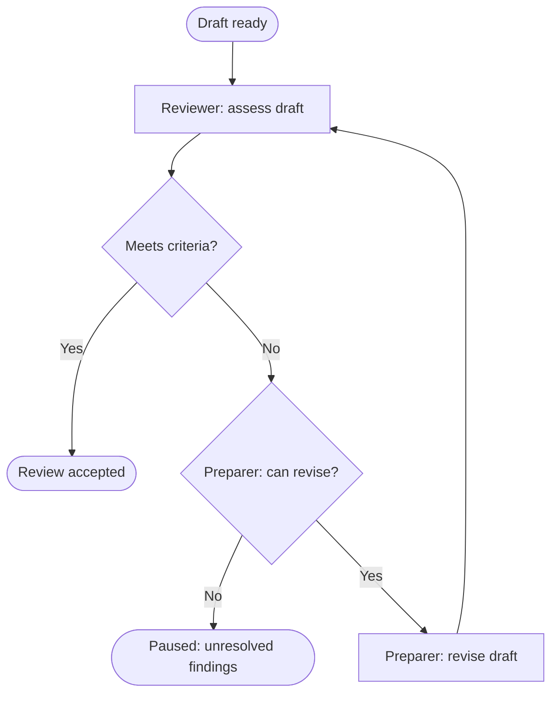

# A bounded review loop

Synthetic proposed workflow: a preparer submits a draft to a reviewer. Arrows
mean the next action; labels on decision edges select the path. Review completes
with acceptance or a pause. This says nothing about publication or deployment.
The example assumes another review is allowed only after requested revisions
are feasible and have been made.

The return path includes a changed draft; rejection alone does not trigger a
repeat. The pause retains unresolved findings rather than implying acceptance.
For an execution workflow, use its actual failure and retry obligations instead
of copying this review loop onto a call to an external service.
