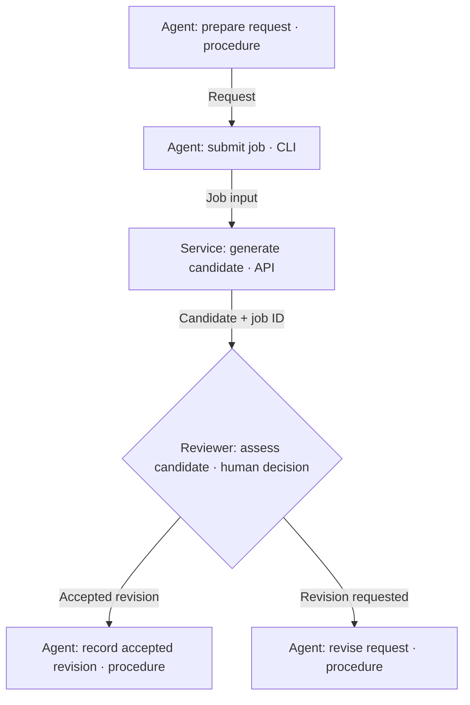

# Construct a swimlane activity view

Use [reading semantics](read.md), shared [composition](../composition.md) and
[verification](../verification.md). This is a lightweight activity convention,
not a new agent protocol or a claim of UML/BPMN conformance.

## Make the handoffs legible

Choose one lane axis and name it in the caption: performer or accountable owner.
Keep that axis consistent; do not mix a team, a lifecycle phase and a storage
location as peer lanes. Separate performer and owner in an activity annotation
when their difference matters. Lanes need not match runtime boundaries.

Trace one real request from trigger to scoped completion. Keep the overview to
consequential activities, decisions and handoffs; put internal steps in the linked
procedure. Name each action with a verb. Add the method only where it answers the
reader's uncertainty: agent follows procedure, agent invokes CLI, service executes,
or human decides. These are descriptive labels, not exclusive types or mandatory
fields. A service call nested inside an agent's task may belong in a sequence detail.

Label meaningful crossings with the artifact, identity or condition handed over.
Place each decision with its actual decision maker, respecting existing delegation.
Show a relevant return or interruption path when it explains continuation. Do not
add a human gate, retry guarantee or runtime solely to complete the drawing.
Link source-owned procedures, commands and contracts from the surrounding page;
avoid copying their instructions into boxes. Distinguish proposed mechanisms from
implemented ones. Check the normal path and an exception against those sources.

## Choose a supported renderer

[Mermaid swimlanes](https://mermaid.js.org/syntax/swimlanes) are documented from
11.16.0 using `swimlane-beta`. Its syntax is evolving: check support and render in
the actual consumer before choosing it. Top-level subgraphs define lanes. Shared
[Mermaid guidance](../mermaid.md) applies where syntax is compatible; flowchart
subgraph direction rules are not swimlane syntax rules.

This fictional example assigns review to a human; it does not prescribe that
allocation for other workflows. Lanes identify performers. Arrow labels describe
results and conditions, not transport. Preparation begins with a supplied brief;
the accepted branch ends at a recorded revision, before any consumer adoption.
The revision branch produces a revised request; another attempt starts at submission.

```mermaid
swimlane-beta TB
    subgraph agent["Agent"]
        prepare["Prepare request · procedure"]
        submit["Submit job · CLI"]
        record["Record accepted revision · procedure"]
        revise["Revise request · procedure"]
    end
    subgraph service["Generator service"]
        generate["Generate candidate · API operation"]
    end
    subgraph reviewer["Reviewer"]
        review{"Assess candidate · human decision"}
    end
    prepare -->|Request| submit
    submit -->|Job input| generate
    generate -->|Candidate + job ID| review
    review -->|Accepted revision| record
    review -->|Revision requested| revise
```

When lanes are unsupported or too wide, use an actor-labelled flowchart with the
same declared meaning. This fallback makes responsibility explicit without relying
on lane geometry. Grouping flowchart subgraphs is another option, but cross-group
edges can override their direction; do not promise aligned lanes from them.



Inspect the real reading width, lane headers, crossings and feedback path. Split
an overcrowded view or use the fallback; do not shrink labels to fit the full
process. A full-width diagram is optional detail, not necessarily the landing page.

## When another form is better

Use a [flowchart](../flowchart/guide.md) for branching with little responsibility
change, a sequence diagram for exact participant exchanges, and a component view
for service boundaries and dependencies. For formal process semantics, follow
[OMG BPMN](https://www.omg.org/spec/BPMN/2.0.2/): pools, lanes, sequence flows,
message flows and task types have defined meanings. An agent following written
instructions does not thereby become a BPMN Manual Task; do not invent a standard
agent task symbol. Use the notation and extensions supported by the chosen tool
when formal modelling is required.
