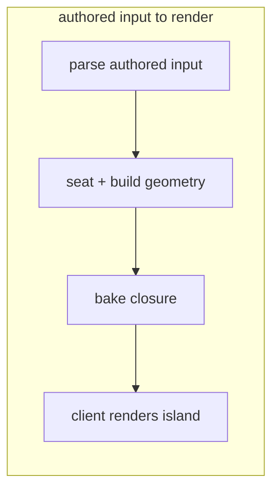
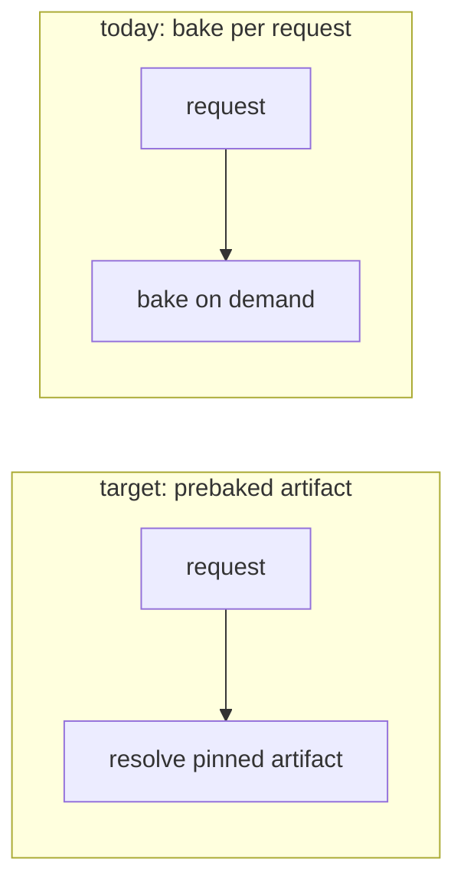
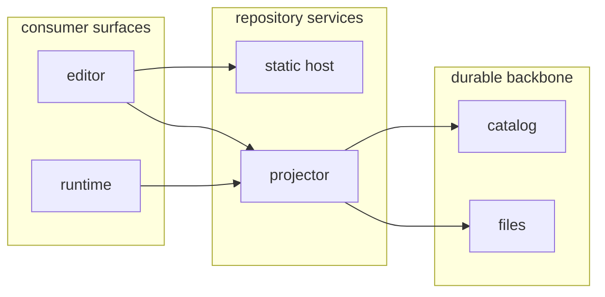
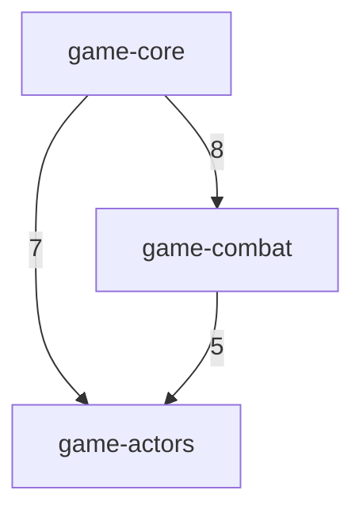
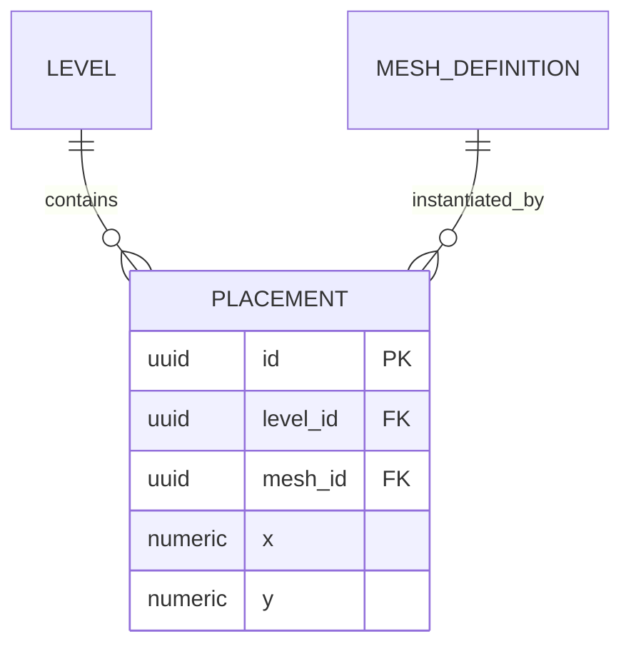

# Drawing conventions

**Read this before writing a Mermaid block or an overview table.** `SKILL.md`
decides *which* form carries a subject; this file covers *how* to draw it so it
renders the same on GitHub, in editor previews, and in the live editor. For a
model to copy, see [worked-examples.md](worked-examples.md).

## Default direction: TB

**Top-to-bottom (`flowchart TB`) is the default.** A vertical flow stays within
the narrow column width of a rendered doc or diff and nests subgraphs
predictably.

`TB` and `TD` are aliases for the same layout; Mermaid lists `TB` first and
documents `TD` as an alias, so **write `TB`** — one keyword that reads the same
at the top level and inside a subgraph `direction`.

Reach for `LR` only when the flow is a genuinely short, linear pipeline that
reads better wide _and_ fits the column, or for the layered-overview pattern
below — not as a habit. **When a wide diagram starts wrapping or shrinking text
to fit, switch it to `TB`.**

`TB` alone does not save a diagram carrying too much. When the block is still
too wide after switching, the problem is altitude rather than direction: split
it, per the black-box rule in `SKILL.md`.

## Subgraphs: always declare `direction TB`

A subgraph with **no** explicit `direction` can lay its chain out left-to-right
regardless of the parent flowchart's direction — a Mermaid quirk that makes
nested flows render inconsistently across renderers. Always make the first line
inside a subgraph `direction TB`:

Without that line, the same subgraph may render horizontally and overflow the
page.

## Side-by-side lanes, and how to stack when they do not fit

Two sibling subgraphs with **no connecting edge** between them render side by
side — whatever the parent direction, and whatever order they appear in the
source. That is the natural form for a before/after pair and it is fine to use,
provided **each lane declares `direction TB`** and the finished block still fits
the target column.

Side-by-side lanes that are internally horizontal are the common failure. A
four-node pair drawn without the inner `direction` measured 2495px wide against
a GitHub issue column of roughly 830px, crushing every label to a third of its
size; the same pair with `direction TB` in both lanes measured 1175px. Two
caveats when using this form:

- **Left/right order is not guaranteed.** Mermaid may place the second subgraph
  on the left. Let the subgraph **titles** carry the before/after meaning, rather
  than position.
- **Neither source order nor an inner `direction` moves the lanes.** Both govern
  what happens *inside* a lane, never where the lanes land.

When the pair is still too wide for the column, or reading order must be
guaranteed, stack it deliberately — either two separate Mermaid blocks, or a
single invisible edge between the two subgraph ids, which ranks them vertically:

## Layered overviews: parallel vertical lanes

A **layered overview** has two or more node-bearing subgraphs connected in a
dependency chain. When the layers read more clearly left to right, set the
top-level chart to `flowchart LR` and keep `direction TB` inside every subgraph:

Only the dependency layers move side by side; each layer remains a vertical
lane. Unlike unconnected side-by-side lanes, connecting edges make the
left-to-right layer order meaningful. This pattern is not a before/after
comparison, whose reading order still belongs in a vertical stack.

Treat layered `LR` as a deliberate exception to the `TB` default, not a general
architecture-diagram direction. It spends horizontal space and is most useful
in a full-width README or architecture document. Test the actual render
context: a diagram that wraps or shrinks in a narrow diff, preview, or sidebar
should return to `TB` or split at the correct altitude. Direction does not
override the overview/detail disposition inventory or the lifecycle split
thresholds in `SKILL.md`; classify or split an overfull diagram before choosing
its layout.

## Parallel edges: one edge, labelled with the count

When several edges of the same kind join the same pair of nodes or groups, draw
one edge carrying the count rather than N parallel edges:

N parallel edges between one pair say nothing the number does not, and they are
the cheapest crossings to remove from a dense block. Keep edges separate only
when they differ in something the diagram is read for — cardinality, direction,
or condition. Give a different *kind* of reference its own edge style instead of
adding it to the count, so one number never mixes two meanings.

## `erDiagram`

Use `erDiagram` for entities and their relationships, and a Markdown table for
the field-level detail.

- **Every relationship needs a label** — a bare `A ||--o{ B` is still a parse
  error on current Mermaid. Write `: ""` when there is genuinely nothing to
  say.
- **Cardinality reads left-then-right**: `||` exactly one, `o|` zero or one,
  `}o` zero or more, `}|` one or more. `||--o{` is the common one-to-many.
- **Never leave a space in an unquoted entity name.** `MESH DEFINITION` does not
  fail — it silently becomes *two* entities, `MESH` and `DEFINITION`, and the
  diagram renders as if that were intended. Use `MESH_DEFINITION`, or quote the
  name. Uppercase is the convention.
- **Use the storage's real types** in attribute lines, and mark `PK` / `FK` /
  `UK`; a trailing quoted string on the line is a comment. An ER diagram whose
  types are invented is worse than none.
- **Show the delta, not the whole schema.** Draw the entities the change
  touches plus their immediate neighbours; link to the schema's canonical home
  for the rest.
- **ER direction and subgraphs depend on the target Mermaid renderer.** Current
  [Mermaid ER syntax](https://mermaid.js.org/syntax/entityRelationshipDiagram.html)
  supports both, but ER subgraphs require version 11.17.0 or newer.
  Check the project's preview or publishing renderer before using them. With or
  without those controls, split past roughly 10–12 entities, or a comparable
  edge count, even when every attribute block is already keys-only. Attribute
  trimming reduces width; it does not make a crowded relationship layout
  tractable.
- **Split by aggregate cluster.** Start with one root-only overview naming every
  aggregate root and only the edges directly between roots, with no children.
  Then open each non-atomic root in its own compact detail `erDiagram`, showing
  its owned children and join tables. This is the ER form of the
  overview/detail black-box pattern in `SKILL.md`, not flowchart-style staging.
- **Elide cross-family stubs unless their cardinality carries information.** A
  target earns a drawn entity and edge only when the relationship distinguishes
  one-to-one from one-to-many for this diagram's own question. For a single
  incoming FK already named in prose or the column table, keep the target
  discoverable as an attribute comment instead:
  `text race_key FK "-> game_races.key"`. That costs no extra entity or
  edge.
- **A target reached by many entities is a fan-in table, not a drawn hub.**
  Shared dependency is the one shape an ER layout cannot absorb: a node with a
  dozen incoming edges crosses every other edge in the block, and it is
  routinely what makes an otherwise splittable diagram unsplittable. When fan-in
  *is* the shape worth showing, tabulate it — one row per referencing entity or
  group, the target named once in the heading — and leave the hub out of the
  graph entirely. Table rows do not cross. `SKILL.md` carries the fan-in shape
  beside the other table shapes.

## Drawing a table or matrix

- **Fill every cell.** A blank reads as "not applicable" and hides an
  unanswered question — write `none`, `n/a`, or `unknown` on purpose.
- **Keep cells short.** A cell that wants a paragraph means the table is at the
  wrong altitude: shrink the cell to a verdict and link to the prose.
- **Watch the width.** A table that scrolls sideways in a rendered doc has the
  same problem as a diagram that is too wide. Drop a column, or transpose the
  axes.
- **One row per case, and say what the rows are.** A table whose rows mix two
  kinds of thing should be two tables.
- **Put the axis in the header**, not in the surrounding sentence, so the table
  still reads when it is quoted into an issue without its paragraph.

## Conservative syntax

Syntax that travels across GitHub, editor previews, and the live editor:

- **`subgraph id [bare title]`** with a space, not a quoted title. Keep Mermaid
  keywords (`direction`, `end`) out of a bare title — they confuse the parser.
- **Quote node labels** — `["…"]` — and use ` ` for line breaks. Quoting keeps
  `(`, `)`, `:` and other punctuation from colliding with node-shape syntax; a
  bare `A[Meshy export (raw)]` is a parse error. Skip other HTML tags — they vary
  by renderer.
- **Never name a node with a reserved keyword** — `click`, `end`, `graph`,
  `subgraph`, `style`, `class`, `direction`, `default`, `call`, `href`,
  `linkStyle`. **`click` is the common trap:** `click["…"]` is read as the
  node-interaction directive, not a node, and the giveaway is a misleading parse
  error reported on the **next** statement, not the offending line. Rename the
  node.
- For a literal `<` or `>` inside a label write `&lt;` / `&gt;` — raw angle
  brackets read as HTML — and avoid `{` `}`, which collide with shape syntax.
- Symmetric dotted-edge syntax: `a -. label .-> b`, with the closing dot before
  the arrow, or `a -.-> b` with no label.
- **`a ~~~ b`** is an invisible link: it ranks the two nodes or subgraphs without
  drawing an edge. Mermaid 9.4 and later, so it travels; use it only to stack
  lanes, never to fake an edge that exists.
