# Worked examples

**Read this when you know which form you need and want a model to copy.**
`SKILL.md` decides the form; [drawing.md](drawing.md) covers the syntax. Each
example below names the failure it replaces, so it is clear what the shape is
buying.

## An overview and its detail, instead of one wide block

**Replaces:** one flowchart holding an authoring lane, a publish boundary, and a
delivery lane side by side — three altitudes in one block, which renders as
squeezed lanes with unreadable labels.

The overview keeps the complex part as a single node:

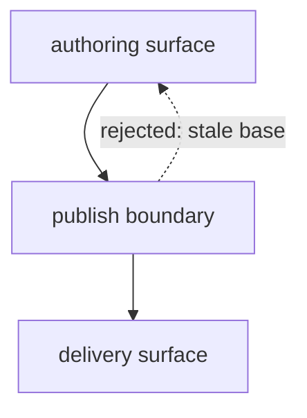

The detail diagram opens that one node, in the doc that owns it. Its title
repeats the black box's label exactly, so a reader knows what they opened:

The publish boundary checks the candidate in this order.

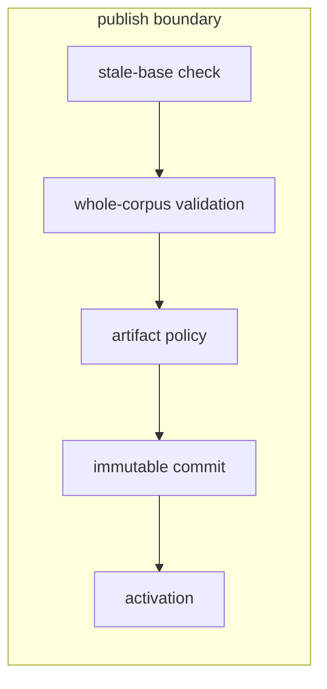

Each diagram now answers one question at full column width. Its opening names
the boundary; review the detail against its source when that boundary changes.

## One overview fanning out to several owned details

**Replaces:** a black-box overview whose outbound links leave locally owned
components unopened, or one oversized diagram that mixes system ownership with
every component's internal flow.

The overview answers only which components meet at the artifact registry:

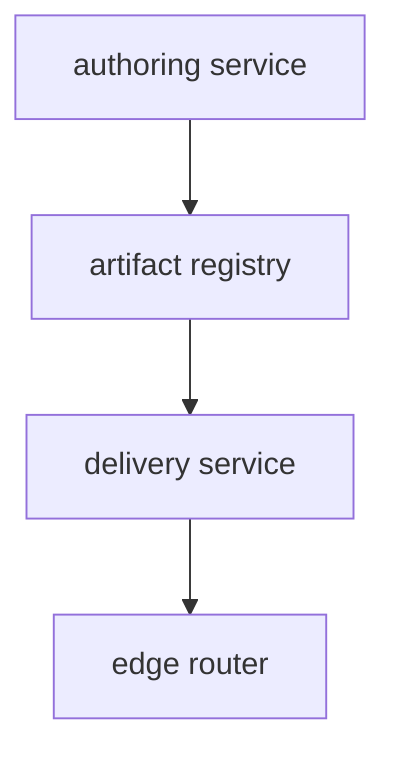

Inventory every black box before drawing details:

| Overview box | Disposition | Reason or destination |
| --- | --- | --- |
| `authoring service` | compact detail here | this doc owns its validation boundary |
| `artifact registry` | canonical detail elsewhere | the storage contract owns its internals |
| `delivery service` | compact detail here | this doc owns its resolution boundary |
| `edge router` | intentionally atomic | only its public handoff matters at this altitude |

The two locally owned boxes each get a compact detail at the same altitude. The
exact overview label appears again, and only the immediate external seams are
redrawn.

The authoring service validates edits before handing them to the artifact registry.

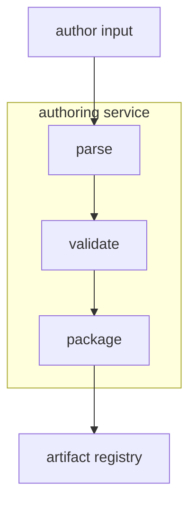

The delivery service resolves a published artifact for the edge router.

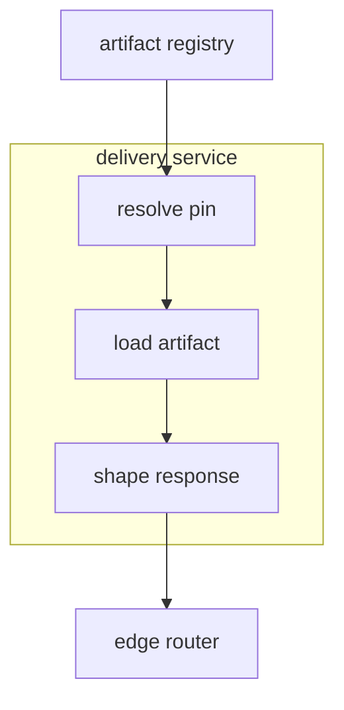

The artifact registry links to its canonical storage detail instead of being
redrawn, and the edge router stays closed for a stated reason. If the reader
also needs request order or retry behavior, draw a separate lifecycle diagram;
that question does not belong inside this ownership set.

## A multi-phase lifecycle split by stage-level question

**Replaces:** one lifecycle that expands every relevant input, optional build
step, and finalization state. No single subgraph has to be enormous for the
whole diagram to answer too many useful questions at once.

The stable-stage overview carries only the end-to-end order. Repeated inputs,
the optional branch's internals, and routine finalization states are collapsed:

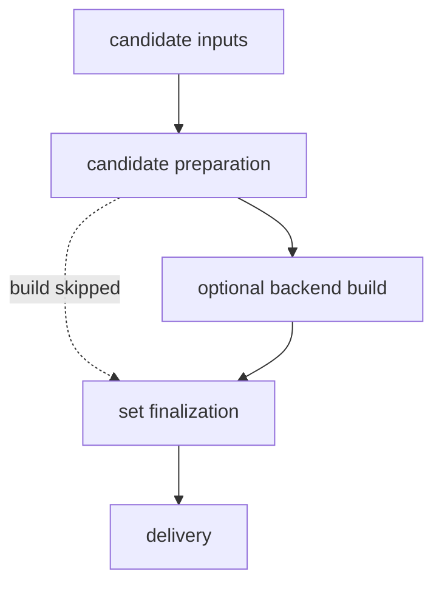

The black-box inventory applies just as it does to a component overview:

| Lifecycle stage | Disposition | Reason or destination |
| --- | --- | --- |
| `candidate inputs` | compact detail here | input fan-in and precedence matter |
| `candidate preparation` | intentionally atomic | its public outcome is enough here |
| `optional backend build` | compact detail here | the conditional lane has load-bearing order |
| `set finalization` | compact detail here | activation states and handoffs matter |
| `delivery` | canonical detail elsewhere | the delivery contract owns its internals |

Each focused detail answers one stage-level question and repeats the overview
label exactly.

Candidate inputs converge on candidate preparation.

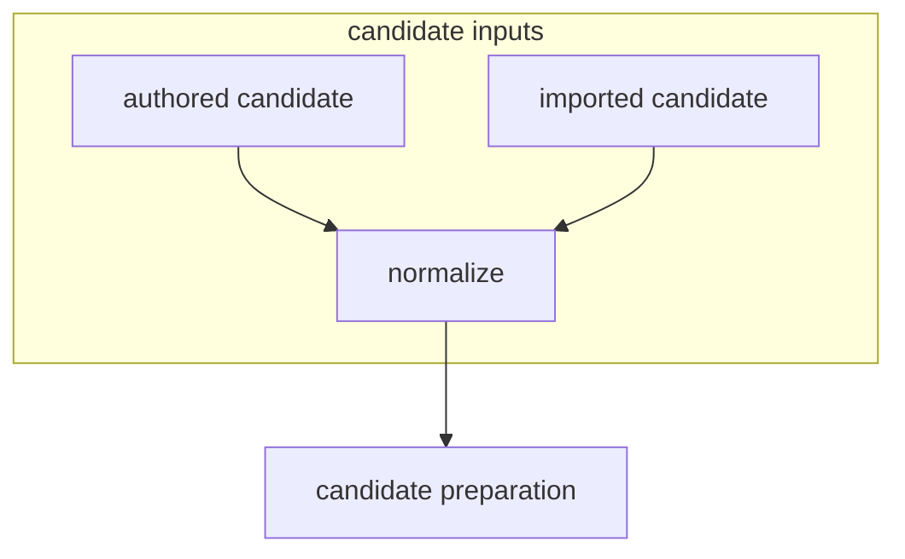

The optional backend build completes before set finalization.

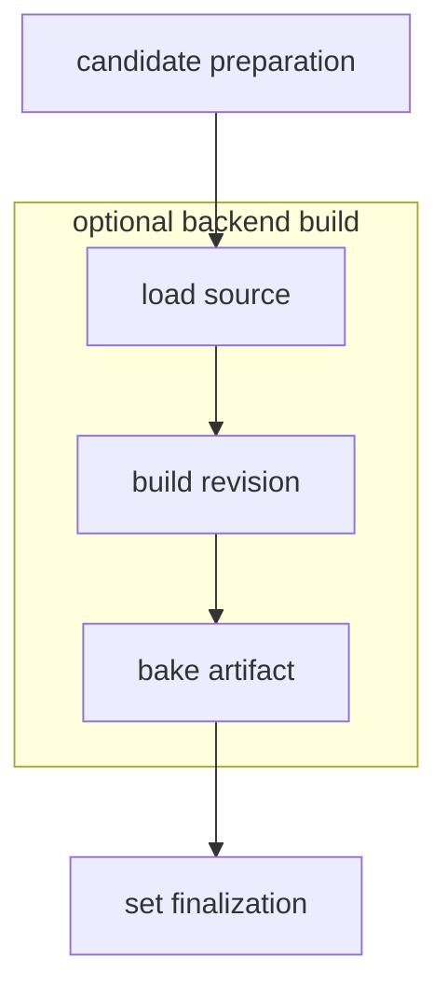

Set finalization commits and activates the selection before delivery.

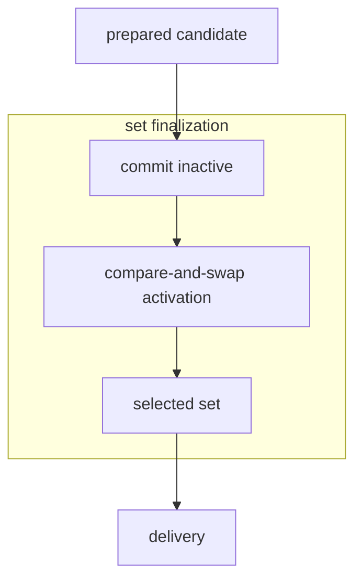

Every node from the oversized version can still be relevant. The split moves
each ordering fact to the diagram whose question needs it; it does not discard
those facts or introduce a third altitude.

## Before / after as parallel vertical lanes

**Replaces:** a paragraph saying "today the response is baked per request;
afterwards it resolves a pinned artifact instead" — true, but the reader has to
hold both flows in their head to see where they diverge.

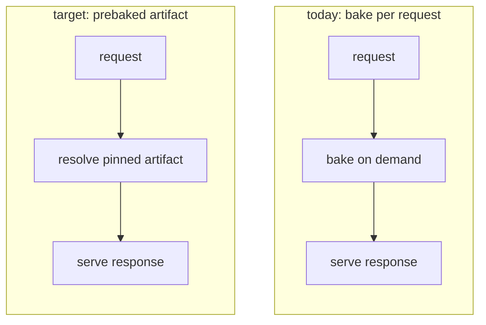

The two unconnected subgraphs sit **side by side**; `direction TB` is what keeps
each lane running top to bottom inside its own box. Omit those two lines and the
same block renders as two horizontal chains several times the column width. When
a pair this size no longer fits, stack it — see `drawing.md`.

The lanes are **comparable on purpose**: three stages each, identical first and
last node, so the single differing stage is the change. A before lane drawn in
six nodes against an after lane of three would hide exactly what it exists to
show.

## A layered overview as parallel vertical lanes

**Source shape:** a content platform's outer dependency map, generalized from a
real repository.

The representative slice below keeps the cross-layer fan-out that determines the
layout; the original owns the complete node and edge inventory.

**Replaces:** the same three dependency-ordered groups stacked in a top-level
`flowchart TB`. Each group was locally readable, but cross-group fan-out met in
one crowded horizontal band and forced readers to trace long diagonal edges.

The crowded layout used vertical subgraphs inside a vertical chart:

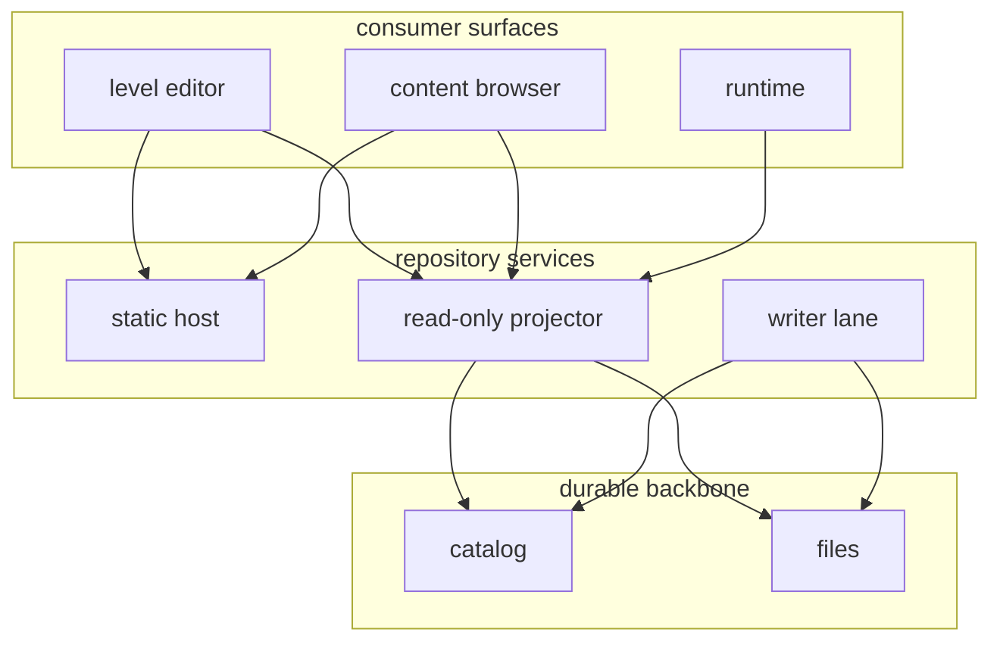

Changing only the top-level direction makes the dependency groups parallel
lanes while preserving each lane's vertical node order:

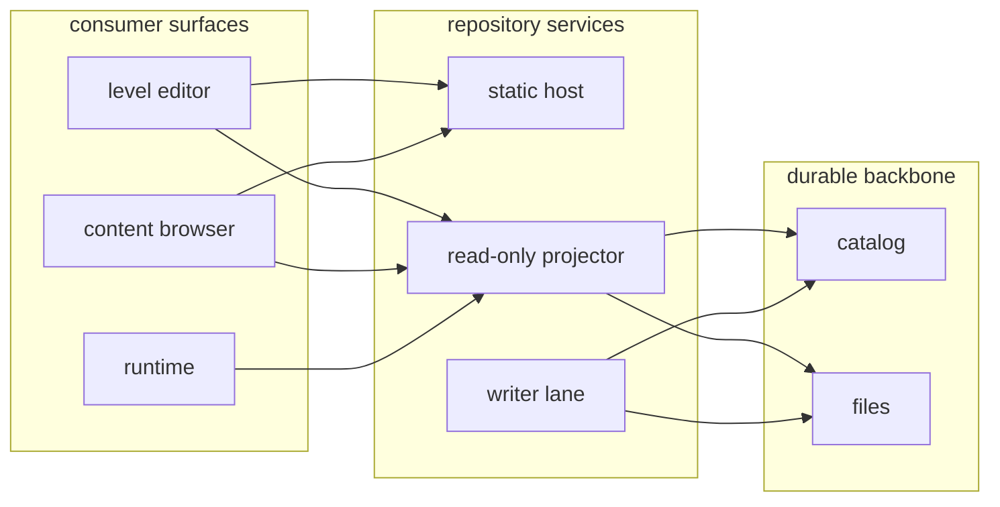

This is a layout change, not an altitude change: the groups already pass the
overview black-box disposition inventory and whole-diagram split tests. If a
lane hides important internals, or the chart also makes readers understand
independent lifecycle phases, open or split those questions first. Use this
wide form only where the actual render gives its lanes enough horizontal room.

## A schema change: ER diagram plus a delta table

**Replaces:** prose walking through each altered column. Two forms, never three
— the diagram carries the relationships, the table carries the field-level
delta, and no paragraph restates either.

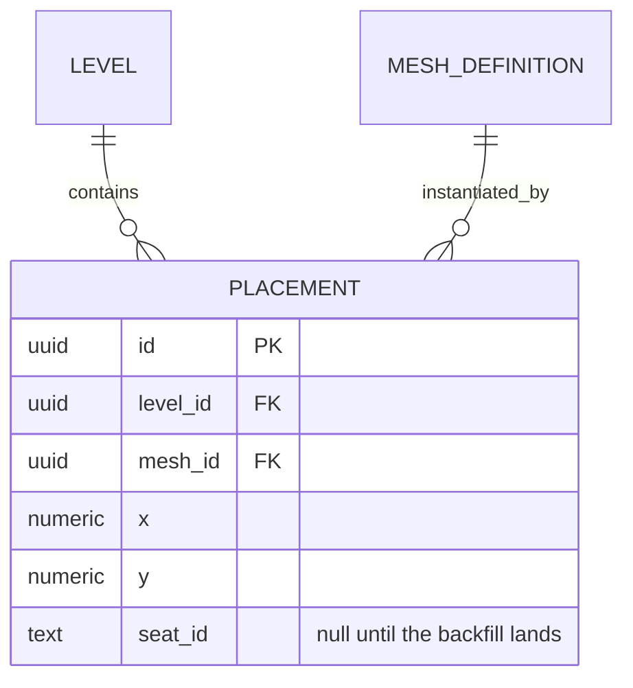

| Column | Before | After | Migration |
| --- | --- | --- | --- |
| `placement.mesh_id` | `text`, the mesh's name | `uuid`, FK to `mesh_definition.id` | backfill by name, then drop the text column |
| `placement.seat_id` | absent | `text`, nullable | added empty; nullable until the backfill lands |
| `placement.x` / `.y` | `float` | `numeric(9,3)` | in-place cast, no data loss |
| `placement.legacy_ref` | `text` | dropped | none — unread since the archive cut |

## A large ER family split by aggregate cluster

**Source shape:** a game database family, generalized from a real
repository.

**Replaces:** the game registry family once drawn as one keys-only
`erDiagram`: fourteen owned tables, nine cross-family target stubs, and
twenty-three relationship edges in one unclustered layout. Moving full columns
to a companion table made the entity boxes thinner, but the remaining graph was
still a hairball because `erDiagram` has no layout controls.

The crowded version mixed aggregate roots, owned children, join tables, and
every single-FK target in one block. Even this relationship-only excerpt shows
the competing clusters and stubs; the source shape had twenty-three entities
and twenty-three edges:

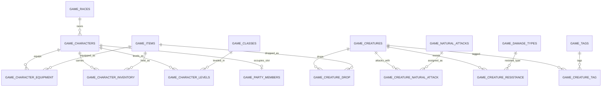

Split first to a root-only overview. It names every aggregate root, keeps the
direct character-to-party cardinality, and summarizes the many-to-many
creature-to-attack relationship carried by the assignment table. The two
standalone roots stay intentionally atomic because they have no children to
open:

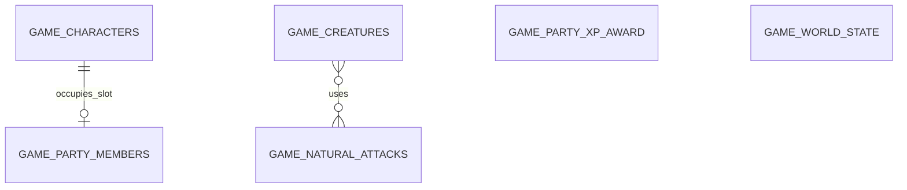

Then open one aggregate at a time. The character detail keeps its three owned
children and immediate party seam. Short display labels keep the relationships
readable; the companion table maps each label to its entity and keeps the key
fields and cross-family FK targets:

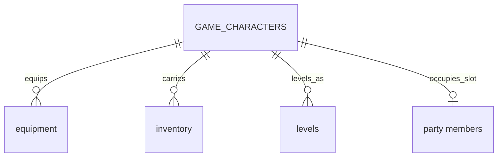

| Diagram label | Entity and selected fields |
| --- | --- |
| `GAME_CHARACTERS` | `game_characters`: `text key` PK; `text race_key` FK → `game_races.key` |
| `equipment` | `game_character_equipment`: `text character_key` PK, FK; `text slot` PK; `text item_key` FK → `game_items.key` |
| `inventory` | `game_character_inventory`: `text character_key` PK, FK; `text item_key` PK, FK → `game_items.key` |
| `levels` | `game_character_levels`: `text character_key` PK, FK; `integer char_level` PK; `text class_key` FK → `game_classes.key` |
| `party members` | `game_party_members`; fields are outside this example |

The creature detail independently opens its children and the join table that
carries the root-to-root natural-attack relationship. Its cross-family targets
stay in the companion table rather than becoming drawn hubs; where that shared
dependency is itself the question, it belongs in a fan-in table, as the next
example shows:

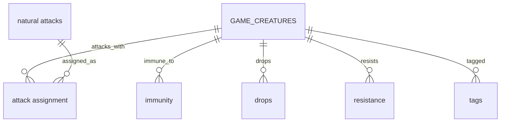

| Diagram label | Entity and selected fields |
| --- | --- |
| `GAME_CREATURES` | `game_creatures`: `text key` PK; `text class_key` FK → `game_classes.key`; `text template_key` FK → `game_templates.key`; `text dice_material_appearance_ref` FK → `material_appearances.ref` |
| `immunity` | `game_creature_condition_immunity`: `text creature_key` PK, FK; `text condition_key` PK, FK → `game_conditions.key` |
| `drops` | `game_creature_drop`: `text creature_key` PK, FK; `text item_key` PK, FK → `game_items.key` |
| `attack assignment` | `game_creature_natural_attack`: `text creature_key` PK, FK; `text natural_attack_key` PK, FK |
| `resistance` | `game_creature_resistance`: `text creature_key` PK, FK; `text damage_type_key` PK, FK → `game_damage_types.key` |
| `tags` | `game_creature_tag`: `text creature_key` PK, FK; `text tag_key` PK, FK → `game_tags.key` |
| `natural attacks` | `game_natural_attacks`: `text key` PK; `text damage_type_key` FK → `game_damage_types.key`; `text scales_with` FK → `game_attributes.key` |

The overview and details are one two-altitude set. The companion tables retain
the selected key fields and cross-family targets; a full schema column table
would also own nullability, defaults, and constraints. Splitting the ER layout
does not add a third form.

## An over-threshold overview raised to its owning documents

**Source shape:** a registry schema's relations overview, generalized from a real
repository, replaced by per-aggregate diagrams in the documents that own them.

**Replaces:** one `erDiagram` naming every table in the schema — 96 entities and
122 relationship edges in a single flat block, several times over the ER split
threshold. The aggregate-cluster split above has no purchase here: the schema
carries roughly forty plausible aggregate roots across eleven families, so even
a root-only overview stays a hairball.

The measurement that chose the remedy was not the entity count. It was this:
**all 122 edges were already drawn on a family page** — 76 inside a family, 46
crossing a boundary — each with its real optionality and a verb label, beside
the columns carrying the constraint. The overview held no fact of its own, and
held every fact it copied less well, since it flattened all 122 to `||--o{` with
an empty label.

That is a duplication finding, not a density finding, and the two have different
fixes. Density prescribes a split, and a correctly split set would still have
duplicated all 122 edges. Duplication prescribes deleting the block and drawing
the altitude above it.

The replaced block, in representative excerpt — the two hubs and one family's
own edges are enough to show why no ER split rescues it; the frozen source owns
the full inventory:

```mermaid
erDiagram
  BLOB ||--o{ ASSET_REVISIONS : ""
  BLOB ||--o{ MATERIAL_ASSETS : ""
  BLOB ||--o{ SKYBOXES : ""
  BLOB ||--o{ RENDER_MODELS : ""
  BLOB ||--o{ MESH_ARTIFACTS : ""
  BLOB ||--o{ PROP_HUD_ASSETS : ""
  BLOB ||--o{ FONTS : ""
  BLOB ||--o{ LEVEL_BAKE_ARTIFACTS : ""
  GAME_DAMAGE_TYPES ||--o{ GAME_WEAPON_DAMAGE : ""
  GAME_DAMAGE_TYPES ||--o{ GAME_SPELL_DAMAGE : ""
  GAME_DAMAGE_TYPES ||--o{ GAME_CREATURE_RESISTANCE : ""
  GAME_DAMAGE_TYPES ||--o{ GAME_NATURAL_ATTACKS : ""
  GAME_TAGS ||--o{ GAME_CONDITION_TAG : ""
  GAME_TAGS ||--o{ GAME_CREATURE_TAG : ""
  LEVEL_ROOTS ||--o{ LEVEL_ENCOUNTERS : ""
  LEVEL_ROOTS ||--o{ LEVEL_HANDLES : ""
```

The altitude above a table is the document that owns it. One node per migration
family — which is also one node per family page — with each edge labelled by the
number of foreign keys crossing that boundary. The nodes are no longer tables,
so the form is a `flowchart`, and it gets rank control the `erDiagram` never
had:

The family map shows foreign-key dependencies and their layer order, with one
node per family page.

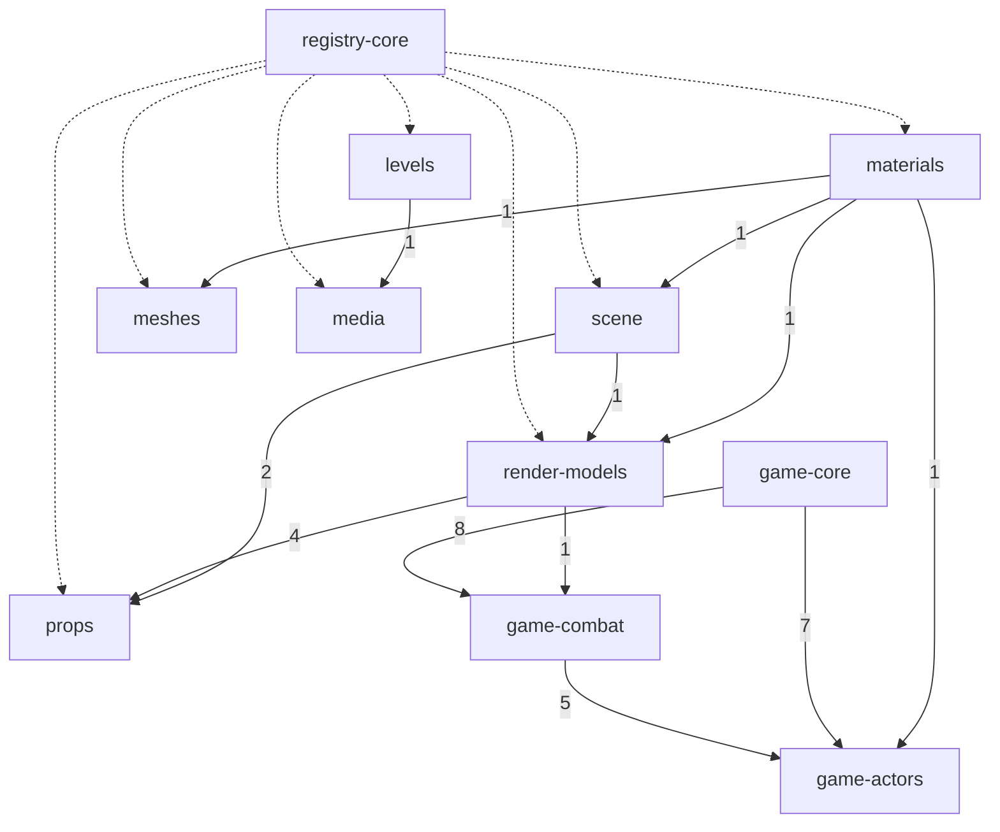

Eleven nodes and nineteen edges replace ninety-six and one hundred and
twenty-two, and the layer order becomes legible for the first time: the asset
families stack, the game families stack separately, and the two stacks meet
at exactly two edges. Collapsed counts are what make it readable — the eight
foreign keys from game-core into game-combat are one labelled edge,
not eight parallel ones — and the dotted edges are a different *kind* of
reference, so they carry no count that could be added to the solid ones.

Two hubs stay out of that graph entirely. Between them they account for 28 of
the 46 cross-family edges — 13 of `blob`'s 15 referencing tables sit outside its
own family, and all 15 game-core references cross a boundary — so drawing
either hub would have put most of the crossings straight back. Each becomes a
fan-in table beneath the map, with the hub named in the heading rather than
drawn:

| Family | Tables holding a `blob` foreign key |
| --- | --- |
| registry-core | `asset_revisions`, `publish_lineage` |
| materials | `material_assets` |
| scene | `skyboxes` |
| render-models | `render_models`, `render_model_appearances` |
| meshes | `mesh_artifacts` |
| props | `prop_hud_assets` |
| media | `creatures`, `fonts`, `font_representations`, `heightmaps`, `music`, `sounds` |
| levels | `level_bake_artifacts` |

| game-core table | Referenced from combat | Referenced from actors |
| --- | --- | --- |
| `game_damage_types` | `condition_damage`, `spell_damage`, `template_resistance`, `weapon_damage` | `creature_resistance`, `natural_attacks` |
| `game_tags` | `condition_tag`, `template_tag` | `creature_tag` |
| `game_attributes` | `weapons` | `natural_attacks` |
| `game_classes` | none | `character_levels`, `creatures` |
| `game_schools` | `spells` | none |
| `game_races` | none | `characters` |

The two tables put their rows on **different axes on purpose**, and choosing that
axis is the whole craft of the shape: `blob` is one target reached from many
places, so the referencing families are the rows; game-core is many targets
each reached from two places, so the targets are the rows and the referencing
families are the columns. Pick whichever axis makes one row a single fact. The
second table's `none` cells are the fill-every-cell rule earning its keep — an
empty cell would have read as an oversight rather than as a real asymmetry.

Nothing was lost in the deletion, because nothing lived here. The family pages
still own every one of the 122 relationships at full cardinality; this altitude
owns only the shapes no single family page can see.

## A coverage matrix

**Replaces:** a section describing each surface in turn. Prose can cover all
three surfaces honestly and still never reveal that one of them answers nothing.

| Surface | Validates on write | Emits audit event | Owns rollback |
| --- | --- | --- | --- |
| editor UI | yes | yes | no — delegates to publish |
| publish API | yes | yes | yes |
| bulk importer | **unknown** | no | **none** |

The importer row is the finding. Two cells nobody could fill are worth more than
the nine that were easy, and they are visible at a glance — which is the whole
argument for the matrix over the paragraph.

## A decision matrix

**Replaces:** three paragraphs arguing for the chosen option. The matrix makes
the runners-up legible enough to be argued *against*, which is what a keystone
decision needs.

| Option | Effort | Reversible | Cost when wrong |
| --- | --- | --- | --- |
| bake at publish | medium | yes — republish | stale artifacts until the next publish |
| bake per request | low | yes | latency on every read, permanently |
| bake nightly | low | no — batch window is fixed | a day of stale reads before anyone notices |

Prose then carries only what the table cannot: *why* the reversibility column
outranks the effort column here.
