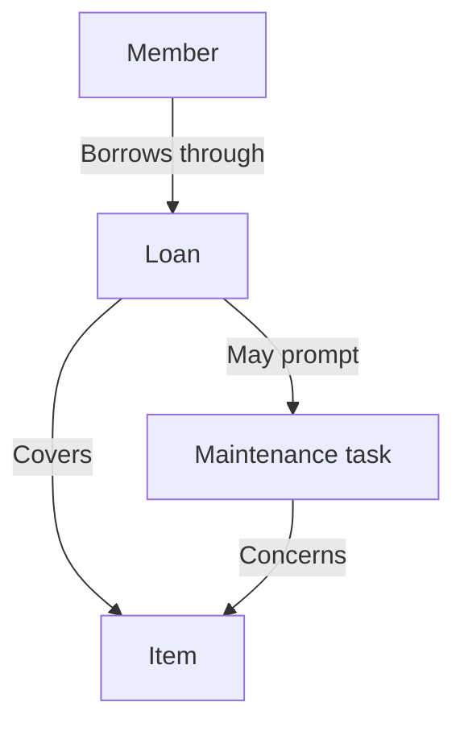
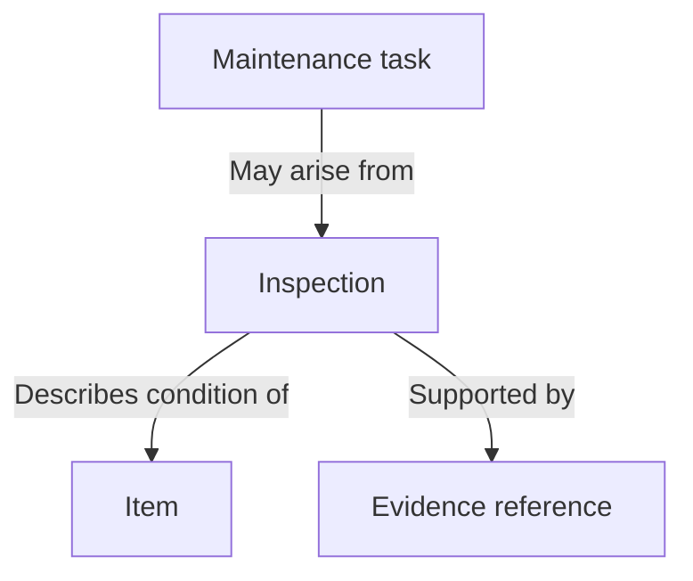

# Worked example: a community equipment library

This synthetic example shows the method on a domain unrelated to the originating
project. Relationships below are stipulated for the example, not claims about an
existing application. All arrows describe conceptual relationships.

## Shared vocabulary

| Term | Meaning |
| --- | --- |
| Member | A person who may borrow equipment. |
| Item | A piece of equipment the library tracks. |
| Loan | A member's borrowing of an item for a period. |
| Inspection | A recorded observation about an item's condition. |
| Evidence | A reference to a photograph or inspection form. |
| Maintenance task | Work needed on an item. |
| Login | An application identity; membership alone does not establish permissions. |

## Borrowing context

A loan connects the borrower and item. Maintenance is work about the equipment;
it is not another loan state. Cardinalities would require the actual data model.

## Condition and evidence

A reported condition and a plan to repair it answer different questions. A task's
existence does not prove that the inspection was correct or that a repair happened.

## Documentation ownership

The entry page points to borrowing instructions, setup and domain explanation.
The glossary defines “loan”; the design page explains its relation to inspections.
A procedure explains how to record an inspection, including the evidence expected.
The release record owns acceptance status. A short handoff links to its remaining
checks instead of copying them.

For an existing project, map these purposes onto its current pages before adding
files. Do not copy this example's entities, workflows or folder choices into it.
