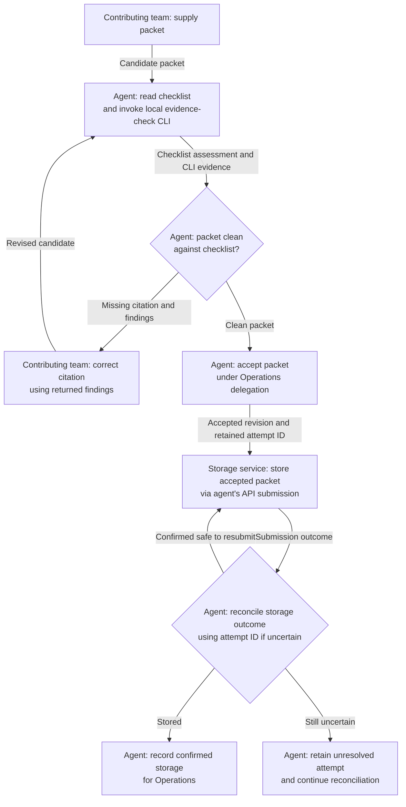

# Fictional compliance packet workflow

Status: proposed explanatory design, 2026-10-04. Operations owns the packet. This view answers who performs the work, how it is performed, and when the packet is both accepted and confirmed stored.

A contributing team supplies a candidate packet. The agent reads the checklist, invokes the local evidence-check CLI, and assesses the packet against the checklist using that evidence. The agent has delegated authority to accept a clean packet. A missing citation returns the candidate and findings to the contributing team; its revision starts a fresh check. CLI success alone does not replace the agent's acceptance decision.

The agent submits the accepted revision to the document storage service through its API and retains the submission's attempt ID. If the outcome is uncertain, the agent reconciles that attempt before any resubmission. The accepted revision and attempt record remain available while the outcome is unresolved. Completion means confirmed storage of that accepted revision, recorded for Operations. A resubmission is allowed only once reconciliation establishes that it is safe; the overview makes no promise about an unspecified provider's retry behavior.

## Activity view

A swimlane activity view fits the responsibility and method question. This source uses its actor-labelled flowchart fallback to keep the overview suitable for a document column; performer labels carry responsibility without requiring aligned lane geometry. Operations is the accountable owner, while the labels identify performers. This is a lightweight activity convention, not BPMN or a process schema.

Source/method legend: The task's fictional scenario supplies the facts. Rectangles are activities; diamonds are the agent's assessments; arrows carry the labelled work, result or condition. “Read checklist” means following an instruction source, “CLI” means executing the local evidence check, and “API” means interacting with the storage service. An arrow alone does not imply a network call. The checklist is a source, not a participant. No checklist file, command syntax, endpoint or provider contract was supplied, so none is invented. The CLI and storage internals stay closed because this overview explains their role and handoff, not their implementation.

## Check and limits

Source walkthrough covered a clean packet, a missing citation followed by a revised candidate, and an uncertain submission that remains unresolved or is reconciled before a possible resubmission. These are fictional paths, not execution evidence. The diagram adds no approval gate.

Mermaid CLI 11.16.0 was available at the supplied cached path. Rendering was attempted at 830px width, but its Chromium process failed to launch with `sandbox_host_linux.cc:41` / `Operation not permitted`. Therefore parsing and visual readability were not verified; this failure is separate from the completed source review. No dependency was installed and no API was executed.

## Routing evidence

Started with fixture `AGENTS.md`, then followed `COLLECTION.md` to project-design for the responsibility/workflow design question. The workflow reference selected the activity/swimlane semantics; shared authoring guidance led to clear-writing and diagrams-and-tables. The document-home map and connected-view reference were read because the design skill routes new explanations through them. Their managed-document and browser details were mostly outside this fixture task. The explicit requested filename and prohibition on a process schema took precedence over creating managed process pages.

Paths below are relative to this fixture. `PF/` abbreviates `installed/project-foundation/`. Word counts are approximate whitespace words from the files, not token counts. “Required” means applicable routing/construction instructions; “useful” means supporting context; “irrelevant portions” identifies read overhead, not an instruction to execute that material.

| File actually read | Words | Material value |
| --- | ---: | --- |
| `AGENTS.md` | 54 | Required: installed-source route; fiction only |
| `PF/COLLECTION.md` | 551 | Required: design and authoring routes |
| `PF/skills/project-design/SKILL.md` | 1,251 | Required: owners, mechanisms, failure case; infrastructure and adoption sections irrelevant here |
| `PF/references/authoring.md` | 250 | Required: writing/visual routes and preserve uncertainty |
| `PF/skills/project-design/references/workflows.md` | 708 | Required: delegated authority, methods, recovery, activity form |
| `PF/skills/diagrams-and-tables/SKILL.md` | 587 | Required: select construction rather than interpretation-only route |
| `PF/skills/clear-writing/SKILL.md` | 593 | Required via authoring; useful concise actor/action wording |
| `PF/references/document-homes.md` | 2,345 file total | Required route; useful placement distinction; most managed-tree, migration and validation material irrelevant; excerpt partly truncated |
| `PF/skills/project-docs/references/view-structure.md` | 1,183 | Required route for view/explanation association; useful caption/status; browser conventions irrelevant |
| `PF/skills/diagrams-and-tables/references/swimlane/read.md` | 246 | Required: performer versus owner; source versus actor |
| `PF/skills/diagrams-and-tables/references/swimlane/design.md` | 639 | Required: handoffs, fallback, delegated decisions |
| `PF/skills/diagrams-and-tables/references/select.md` | 331 | Required: select by reader question |
| `PF/skills/diagrams-and-tables/references/composition.md` | 1,300 | Required construction route; useful closed-box and width guidance; multi-view decomposition mostly irrelevant |
| `PF/skills/diagrams-and-tables/references/verification.md` | 524 | Required: grounded edges and distinguish source/parse/visual checks |
| `PF/skills/diagrams-and-tables/references/mermaid.md` | 1,136 | Required syntax route; useful quoted labels/TB; layered and parallel layout examples irrelevant |
| `existing-view.md` | 80 | Useful existing-view check: publication context answers another scenario, so no replacement or copied owner names |
| `PF/references/status-and-evidence.md` | 590 | Required status route; useful distinction between design walkthrough and execution |
| `PF/templates/views/view.md` | 161 | Required default-template route; useful framing; omitted empty scaffold fields |
| `PF/skills/clear-writing/references/short-text.md` | 365 | Required label route; useful concise activity labels |

The 19 source files total 12,894 whitespace words. Approximately 12.7k words reached the reading context because one batched output elided part of document-homes (roughly 200 words; the tool reported 289 tokens truncated inside that excerpt). That excerpt was not re-read. No content read was intentionally repeated; the counting command reread bytes solely to compute these totals. The authored Mermaid source was read once by the assembly script and consumed by the attempted render, which failed before parsing. These generated-source accesses are separate from the instruction-read total.

No prior trial output or source authoring repository was read. No prior trial interpretation was reused. Project instructions and the task scenario remained available in conversation context. `rg --files` listed fixture filenames; `PROVENANCE.md` was not read. A Git-root probe established that the fixture is outside Git, so writing directly respected the worktree instruction. The renderer version command executed the supplied CLI but its implementation source was not inspected.

Missed guidance: no material requirement known to be missed in the completed source design. The required visual inspection could not be completed because the browser failed to launch; renderer readability remains unknown. Some document-home text was not visible due to truncation, as recorded above. A policy/bootstrap/schema workflow was not opened: the fictional task's scope, ownership, authority and requested output were already explicit, and this trial does not adopt or implement a project system. Integration-choice and project-contracts routes were not opened because the API mechanism and reconciliation obligation were supplied rather than being selected or specified here.

Preserved constraints: Operations ownership; checklist-driven agent work; local CLI evidence; delegated agent acceptance; findings returned to the contributing team for a missing citation; API storage of the accepted packet; attempt-ID reconciliation before resubmission; no extra human approval; no live actions, API implementation, process schema, installation, source-repository reads or unrelated fixture edits.
