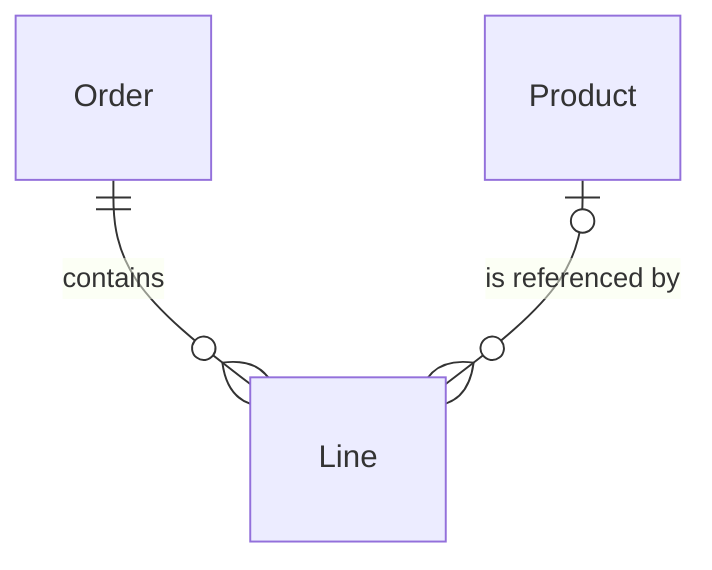

Proposed model: each Line belongs to exactly one Order and optionally references one Product; either can have zero or more Lines. Attributes and implementation remain unspecified. Line style makes no claim about identifying relationships.

Source cardinalities checked against context.md. Parsing and visual inspection are deferred to the parent’s renderer checks.
