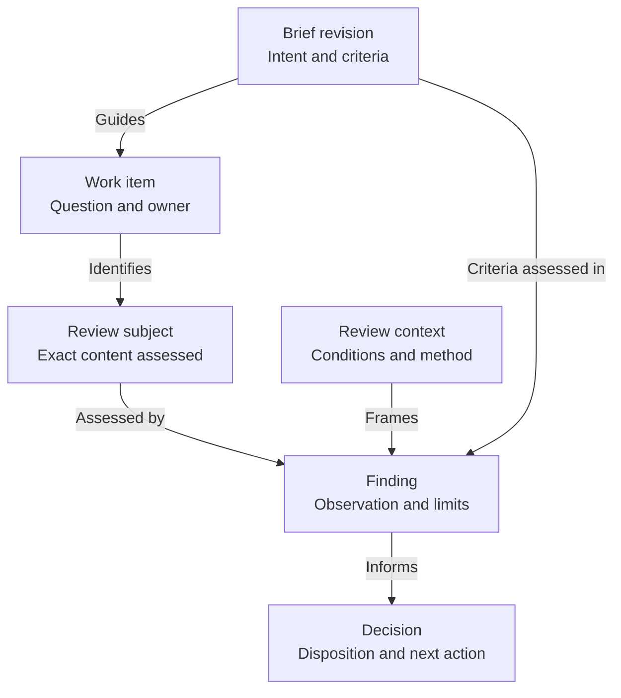

# The work-record chain

Six concepts connect a bounded assignment to a scoped decision. They are not
six required files. Each answers one reader question and has an owner; several
can share a report or worklog entry when their meanings stay distinguishable.

A brief says what should be achieved and how it will be assessed. A work item
names the change or investigation intended to meet it. A review subject is the
exact content assessed. A review context is the conditions under which it was
assessed. A finding is an observation with its limits. A decision says what the
findings mean for the intended use and what happens next.

## Document boundaries

These names describe reading tasks, not prescribed document subtypes. The
project selects concrete shapes. A brief may be a bounded plan item; a report,
study or handoff may be one record; a worklog collects dated records. Their
purpose, owner and assessed basis remain explicit.

| Document | Keeps | Typical owner |
| --- | --- | --- |
| Brief | Assignment intent, inputs, constraints, criteria, coordination state and next action | Commissioning owner |
| Report | A dated result against identified brief revisions, findings, limits and disposition | Performing or reviewing owner |
| Worklog | Dated progress, decisions and links to reports or retained evidence | Owner of the work being recorded |
| Study | Candidates, comparable conditions, observations and a recommendation for an open choice | Owner performing the comparison |
| Handoff record | An identified transfer, checked properties, gaps and receiver's next action | Sending owner |

A living subject specification belongs to the project's domain owner. It can
support several bounded briefs; it need not pretend to be one finishable
assignment. The [assignment contract](assignment-contract.md) owns how to split
work and make each assignment's inputs and return discoverable.

Document purpose, assignment `Kind` and coordination `Workflow` are distinct.
`Kind: experiment` alone cannot identify a file as a brief or a report. The method defines these purposes in prose; the optional metadata checker
does not classify document shapes or validate their associations.

## What connects to what

This is a relationship view. Arrows name relationships between records, not
execution order. One brief can lead to several work items and reviews.

A decision can finish a scoped question, ask for more evidence, request work or
revise the brief. A new decision keeps its links to earlier evidence; it does not
rewrite that evidence to match the latest intent.

## What each record keeps explicit

| Record | Keep explicit | Typical owner |
| --- | --- | --- |
| Brief revision | Stable name and revision; intended use; applicable source revisions; constraints, defaults and local choices; criterion identifiers; adopted choices separated from proposed tests and open questions | The commissioning owner |
| Work item | Brief revision and criteria addressed; bounded question or change; responsible repository; dependencies and completion evidence | The project's planning owner, with technical detail in the performing repository |
| Review subject | Exact files and revision with relevant dependencies; what was included or excluded | The owner of the assessed content |
| Review context | Method, relevant settings and conditions; acting reviewer; run identity when executed | The repository performing the review |
| Finding | Criterion assessed; observation or measurement; evidence location; uncertainty and limits | The repository performing the review |
| Decision | Findings considered; disposition for the named use; acting decision-maker and authority; next owner or completion | The owner of the decision being made |

For Markdown records, the record identifier, human revision and commit identify
the reviewed content together. Record the commit when performing the review.
Changed intent or criteria take a new revision with the reason in the work
record. Editorial clarification can retain the revision; exact content is still
identified by its commit. Findings stay attached to the version actually assessed.

## Keep the assignment input separate from its output

The brief, including a plan item serving as one, is the assignment input: intent, constraints, criteria, current
coordination state and next action. Execution observations, comparative
recommendations, design returns and dispositions belong in a linked record, not
appended to the brief as a results section. Identify the brief revision actually
assessed in that record and link it from the brief without copying the findings
back. A brief may link historical results without making them inputs to a new run.

Do not create a second authoritative status. The brief's coordination state and
next action live in the brief; dated findings and decisions live in the record.
Where a project already has an adequate work record, use it rather than adding
another. The brief identifies the requested reporting form. Use a separate
report when the result
needs to be read as a whole; a short result can remain a dated worklog entry.
Do not require both for every task.

One brief may have several reports, each identifying the revision and scope it
assesses. A report addressing several briefs names each assessed basis and
keeps their findings distinct. Link reports from the brief and progress record
without copying their findings into either. A study can be the requested return
for a comparison; no second report is needed to restate it.

Separate an executor's completion claim and recommendation from the deciding
owner's disposition. Report unresolved acceptance as unresolved. The presence of
a report alone does not set the brief to `done`; use its completion condition.

## Criteria state what evidence would answer them

A criterion names an observable question and the evidence that would settle it.
Distinguish measurable geometry, reproducibility conditions and perceptual or
subjective judgement. "The target is three metres from the camera" is a
geometric claim; "it looks three metres away to this observer" is a finding
under a particular viewing setup. Neither is proof of the other.

If a success threshold is still open, record that and collect observations
without claiming acceptance against an invented limit. Inconclusive evidence can
close a deliberately bounded investigation when its decision owner records that
outcome; missing required work alone does not satisfy completion.

## Route feedback to the thing that changed

| Finding or proposed change | Decision and follow-up | Preserve |
| --- | --- | --- |
| The result differs from a specified measurement | The performing owner corrects or explains the subject, then repeats the affected measurements | The earlier subject identity and its findings |
| The conditions differ, or the observation changes with them | Record a new review context; assess it against the same criterion | The fixed subject and each comparison's settings |
| Intended use or a success criterion changes | The commissioning owner revises the brief and identifies which findings remain applicable | The earlier brief, decisions and the scope of existing evidence |
| Evidence is incomplete or contradictory | The reviewing owner records the unresolved question and the smallest useful follow-up | The uncertainty; no assumed acceptance |

A new subject or review basis may need a separate brief rather than reopening a
completed one. Shared subjects and parent briefs are ordinary explicit links,
not inferred progress dependencies.

## Authority stays where the project put it

These records organize work; they grant no authority. The person or role who
directs intent still directs it, and existing delegation still applies. Each
consequential review or decision records its acting person or agent. This does
not require repeating permission already given, and it does not make a recorded
disposition into acceptance by an owner who did not give it.

A completed assignment is not adoption of its subject. State the disposition for
the named use and link the actual adoption decision where one exists.
